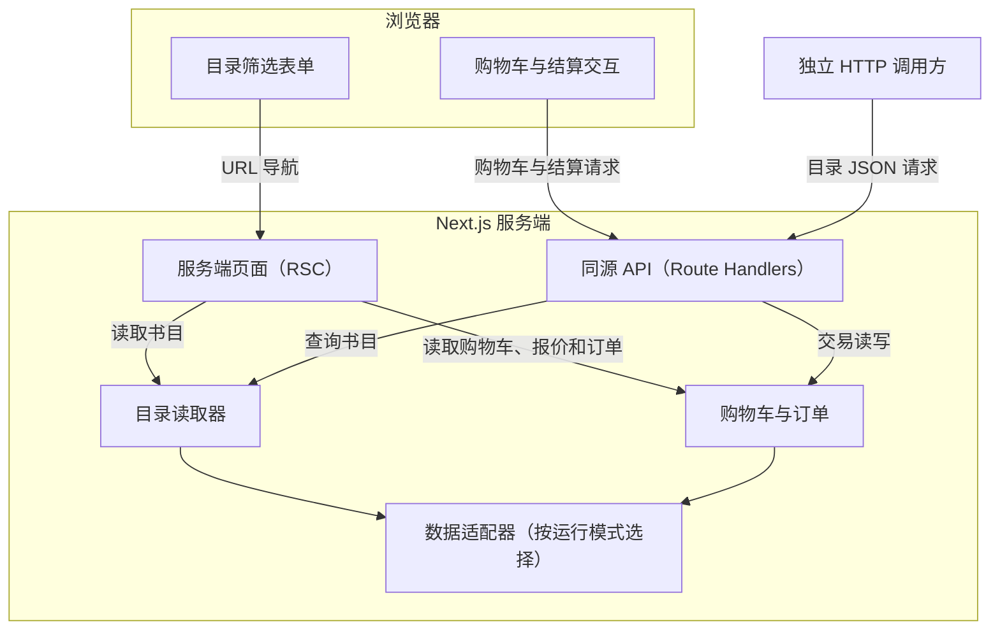

# React Reference Architecture

「页间书店」是一个以服务端渲染为主的 React 应用。代码按目录和结算两个业务模块组织，Next.js App Router 将它们组合成页面。浏览书目时，页面直接在服务端读取数据。修改购物车或确认报价时，浏览器通过同源 HTTP 接口提交变更。

## 架构总图

## 架构导读

| 章节                                                                             | 在书店里解决什么问题                                                     |
| -------------------------------------------------------------------------------- | ------------------------------------------------------------------------ |
| [业务模块与页面组合](docs/architecture/overview.md#业务模块与页面组合)           | 购物车需要目录的书封。页面组合两个模块，各自维护展示与交易规则。         |
| [服务端渲染与客户端交互](docs/architecture/overview.md#服务端渲染与客户端交互)   | 书目读取较慢时，服务端先发页面标题。读者提交筛选时，浏览器再发起导航。   |
| [状态归属与恢复](docs/architecture/overview.md#状态归属与恢复)                   | 输入中的关键词留在表单里，已提交的筛选可用链接分享，私有报价按会话恢复。 |
| [数据入口、适配器与缓存](docs/architecture/overview.md#页面首屏与独立-http-调用) | 页面和 JSON 接口共用目录读取器，由读取器选择数据源及缓存策略。           |
| [并发写入与异步结算](docs/architecture/overview.md#并发写入与异步结算)           | 两个标签页改同一条目时校验版本。下单响应丢失时，用同一报价重试。         |
| [从筛选书目到确认订单](docs/architecture/overview.md#从筛选书目到确认订单)       | 沿一次购书流程追踪查询、购物车版本与报价 ID，看各部分如何衔接。          |

## 本地启动

使用 Node.js 24 和 pnpm 11.25.0 即可独立运行书店。下图是演示书店的中文目录。顶部表单承接筛选输入，下方书卡展示本页书目的价格与库存。[本地启动命令](docs/operations/run-and-release.md#本地演示)

## 文档

[文档索引](docs/README.md) · [运行与发布](docs/operations/run-and-release.md) · [测试入口](docs/testing-strategy/README.md#运行入口)
