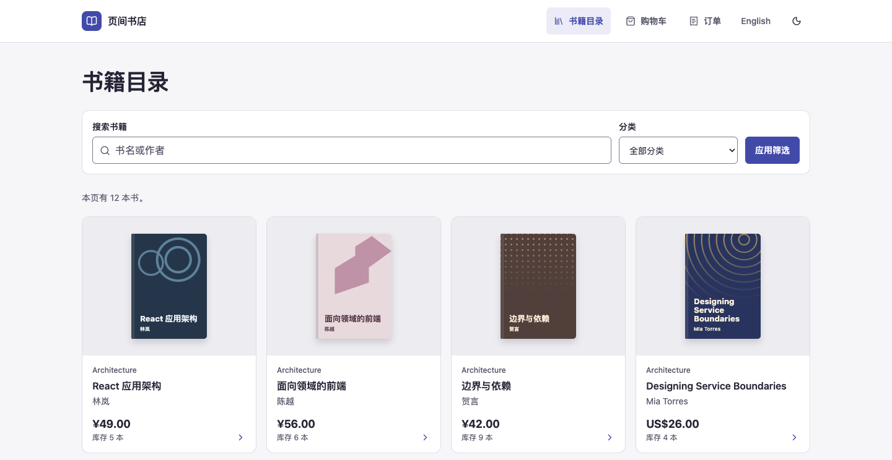

# React Reference Architecture

「页间书店」是一个 React 前端架构参考实现，展示如何按业务组织代码、在服务端渲染页面，并通过同源 BFF 完成浏览目录、加购、报价、下单和查看订单。

## 架构案例

- **首屏读取与独立 HTTP 调用。** 目录页在 RSC 中读取数据，HTTP 调用方通过 Route Handler 读取 JSON。两个入口共用服务端读取器。[案例说明](docs/architecture/overview.md#页面首屏与独立-http-调用) · [目录页](<src/app/%5Blocale%5D/(store)/books/page.tsx>) · [目录接口](src/app/api/v1/catalog/books/route.ts) · [书目一致用例](test/e2e/catalog-journey.spec.ts#L53) · [流式外壳用例](test/e2e/catalog-journey.spec.ts#L279)
- **筛选、表单与交易状态放在哪里？** 已提交的筛选在 URL，未提交的输入在表单，购物车与报价由服务端按会话读取。[案例说明](docs/architecture/overview.md#渲染与状态归属) · [筛选表单](src/features/catalog/ui/catalog-filters.tsx) · [报价确认入口](<src/app/%5Blocale%5D/(store)/cart/page.tsx>) · [筛选导航用例](test/e2e/catalog-journey.spec.ts#L69) · [交易资源隔离用例](test/e2e/bookstore-checkout-http.spec.ts)
- **并发写入与异步结算。** 购物车用版本保护写入，报价固定交易输入，提交可用同一个幂等键重试并单独查询状态。[案例说明](docs/architecture/overview.md#并发写入与异步结算) · [条目接口](src/app/api/v1/cart/items/%5BbookId%5D/route.ts) · [提交接口](src/app/api/v1/order-submissions/route.ts) · [购物车冲突与结算用例](test/e2e/bookstore-checkout.spec.ts)

## 本地启动

Demo 按浏览器会话保存购物车，按币种报价，并在 SQLite 事务内同步落单和扣减库存。

使用 Node 24 和 pnpm 11.25.0。在仓库根目录初始化 SQLite 演示数据并启动前端。

```bash
pnpm install --frozen-lockfile
export DEMO_DATA_DIR="$PWD/.bookstore-demo"
pnpm demo:seed
pnpm dev:mock
```

打开 [中文书籍目录](http://127.0.0.1:3000/zh-CN/books) 或 [英文书籍目录](http://127.0.0.1:3000/en/books)。



上图为 Demo 模式。

## Java 集成

Release 接入 Java v1 目录和订单 API，通过 Keycloak 登录。书店账号页支持自助注册和邮件找回密码，登录后回到发起页面。BFF 在 PostgreSQL 中按账户保存购物车草稿，Java Order 生成人民币报价并处理可能异步的提交，目录从 Java 读取当前库存。[配置与启动](docs/operations/run-and-release.md#java-集成)

[架构与开发文档](docs/README.md) · [API 契约](contracts/java/README.md) · [测试入口](docs/testing-strategy/README.md#运行入口)
