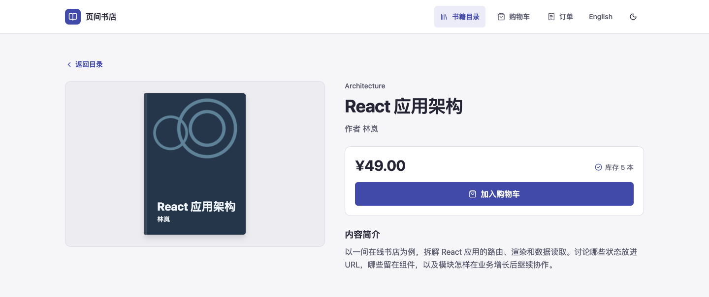
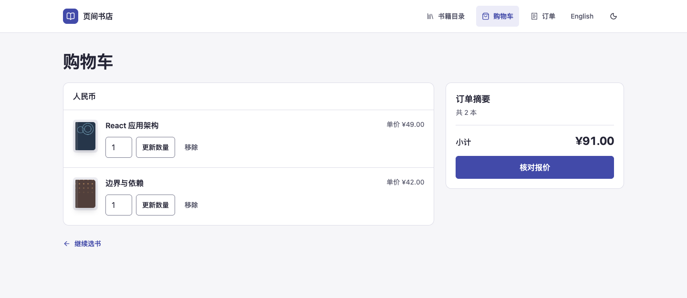
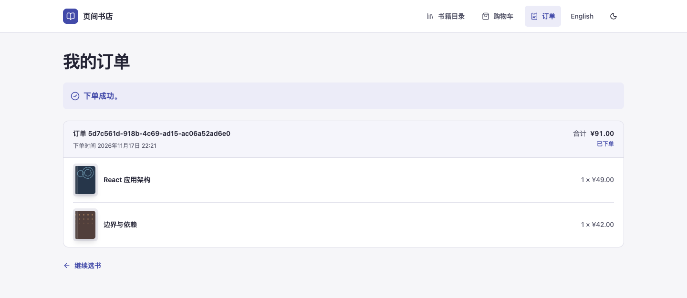
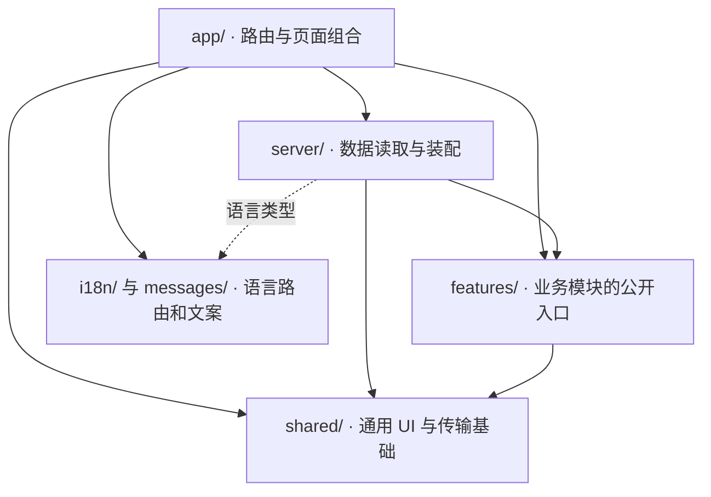
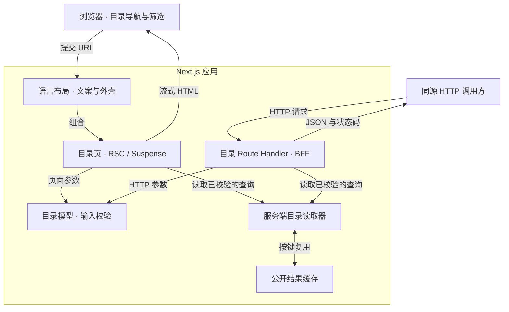

# React Reference Architecture

**在线书店 · 前端架构参考实现**

本项目以「页间书店」为例，展示业务模块、服务端渲染、浏览器交互和同源 HTTP 接口如何协作。本地 demo 可以选书、调整购物车、演示下单并查看订单。代码的路径和导入关系标明模块归属、运行环境和依赖方向。

## 本地启动

使用 Node 24 和 pnpm 11.25.0。在仓库根目录安装依赖、为演示模式写入独立的 SQLite 种子并启动开发服务：

```bash
pnpm install --frozen-lockfile
export DEMO_DATA_DIR="$PWD/.bookstore-demo"
pnpm demo:seed
pnpm dev:mock
```

打开 [中文书籍目录](http://127.0.0.1:3000/zh-CN/books) 或 [英文书籍目录](http://127.0.0.1:3000/en/books)。从列表进入详情加购，在购物车选择「核对报价」，确认书目和金额后「演示下单」，随后进入我的订单。购物车、报价、订单和库存保存在本地 SQLite，私有数据按浏览器区分。已有 demo 数据时重新运行 `pnpm demo:seed` 即可升级表结构并保留数据。[运行与发布手册](docs/operations/run-and-release.md)

## Java 集成

发布构建可通过运行环境选择 Java v2 集成。访客可以浏览和搜索目录。登录后，购物车跟随 Keycloak 账户，人民币报价、下单提交与订单记录来自 Java Order 服务。购物车和订单可以在同一账户的其他浏览器重新打开。默认的 Java v1 目录模式提供分类、分页和详情。[Java 集成配置](docs/operations/run-and-release.md#java-v2-集成)

## 演示截图

### 书籍列表


### 书籍详情



### 购物车



### 订单



## 架构演进之路

### 按业务功能组织代码

目录的筛选表单、查询规则、链接生成和书籍卡片会一起变化。把它们归到 `features/catalog`，这个模块就能完整表达目录功能。`app/` 负责匹配 URL、选择布局和组合页面。`shared/` 中的 Button 和 Input 提供通用交互能力，由目录组件决定它们在书店里的用途。[目录模块](src/features/catalog/) · [基础组件](src/shared/ui/)

### 用服务端组件组装页面，在浏览器处理交互

React Server Components（RSC）让目录页面在服务端读取数据和组合视图。服务端渲染（SSR）负责生成首屏 HTML。目录页面用 `Suspense` 划出请求时获取内容的部分，标题和加载提示可以先到达浏览器，书籍列表随后流式返回。筛选表单的 HTML 可以随页面返回，事件处理和导航在浏览器激活。[目录页面](<src/app/%5Blocale%5D/(store)/books/page.tsx>) · [筛选表单](src/features/catalog/ui/catalog-filters.tsx)

### 让状态回到需要它的地方

一条目录链接就能表达访问语言、筛选条件和当前页。刷新、分享链接或浏览器后退时，页面据 URL 恢复查询。表单只持有提交前的输入，应用筛选时生成新 URL 并回到第一页。[目录链接](src/features/catalog/ui/links.ts)

| 状态               | 所有者       | 在目录中的表现                                                                          |
| ------------------ | ------------ | --------------------------------------------------------------------------------------- |
| 页面语言           | URL 路径     | `/zh-CN/books` 与 `/en/books` 对应两套翻译。切换语言保留当前路径后缀和查询。            |
| 已提交的筛选与分页 | URL 查询参数 | `?category=Architecture&page=2` 可以直接访问和分享。第一页省略 `page`，模型默认取 `1`。 |
| 编辑中的筛选条件   | 表单         | 用户提交后才更新 URL，输入过程中的状态留在控件内。                                      |
| 书籍列表和详情     | 服务端读取器 | 页面和同源接口共享读取逻辑及符合条件的公开结果。                                        |
| 主题偏好           | 浏览器       | `localStorage` 保存选择，根节点的 `data-theme` 通过语义色变量更新界面。                 |

### 让页面和同源接口共用读取逻辑

页面在 Next.js 进程内直接调用 `readCatalog` 或 `readBook` 并生成视图。Route Handler 作为 BFF（Backend for Frontend），负责同源 HTTP 请求与 JSON 响应。两者通过同一份目录模型校验输入，共用同一个读取器，分别决定数据如何出现在页面或 HTTP 响应中。[目录模型](src/features/catalog/model.ts) · [目录读取器](src/server/catalog.server.ts) · [列表 Route Handler](src/app/api/v1/catalog/books/route.ts)

## 模块与依赖方向



箭头表示目录场景里的主要源码依赖。`app/` 和 `server/` 可以组合功能，由 `features/` 管理本模块的内部实现。跨功能组合经过公开入口，基础组件和类型在依赖链下方复用。

| 位置                       | 职责                                                         | 对应代码                                                                                                                              |
| -------------------------- | ------------------------------------------------------------ | ------------------------------------------------------------------------------------------------------------------------------------- |
| `src/app/`                 | 声明路由和布局，解析路由输入，组合视图与 HTTP 响应。         | [目录页](<src/app/%5Blocale%5D/(store)/books/page.tsx>) · [详情接口](src/app/api/v1/catalog/books/%5BbookId%5D/route.ts)              |
| `src/features/catalog/`    | 定义书籍和查询模型，封装目录 UI，声明模块对外的能力。        | [client.ts](src/features/catalog/client.ts) · [model.ts](src/features/catalog/model.ts) · [server.ts](src/features/catalog/server.ts) |
| `src/server/`              | 装配服务端读取能力，统一运行配置、数据复用与 HTTP 错误响应。 | [目录读取器](src/server/catalog.server.ts) · [响应工具](src/server/http/response.server.ts)                                           |
| `src/shared/`              | 提供基础 UI、样式工具和公共传输类型。                        | [Button](src/shared/ui/button.tsx) · [BFF 类型](src/shared/api/generated/bff.ts)                                                      |
| `src/i18n/` 与 `messages/` | 定义可用语言、路由规则与本地化词典。                         | [语言路由](src/i18n/routing.ts) · [中文词典](messages/zh-CN.json) · [英文词典](messages/en.json)                                      |

## 关键设计取舍

### 公开入口明确可用能力，组件指令明确执行环境

`client.ts` 集中导出可以进入浏览器依赖链的组件和工具。`server.ts` 提供仅供服务端使用的 `CatalogPort`。`model.ts` 集中存放数据形状、校验和纯规则，供页面与接口复用。交互组件用 `'use client'` 标记浏览器边界，敏感配置与读取模块用 `server-only` 标记。这样同一个 feature 可以表达模型、服务端接口和浏览器交互，同时保持各自的导入边界。[公开入口与依赖规则](docs/architecture/architecture-spec.md#公开入口与依赖方向)

### 缓存常见的公开查询

查询条件是 URL 的一部分，自由关键词、任意分类和深页组合会产生大量低复用的结果。演示和 Java v1 目录读取器只缓存无关键词且类别为空或属于配置选项的前十页，并为详情使用独立的 UUID 缓存。Java v2 公开目录直接读取当时的书目、分类和库存。缓存按数据集、语言和规范化参数隔离。列表和详情都配置了 60 秒再验证与 300 秒过期，期间结果可能短暂落后于数据源。Route Handler 的 `Cache-Control: no-store` 限制的是 HTTP 响应缓存，读取器仍能复用符合条件的公开结果。[公开读取与缓存 ADR](docs/adr/0002-public-reads-and-cache.md)

### 同一输入规则对应各自的反馈

目录模型限定页码为 1 到 100，校验分类、关键词和 UUID。页面读取 URL 后选择本地化的空结果、重置、缺失或重试提示。HTTP 入口按 OpenAPI 返回结构化 JSON，失败时返回状态码和 `{ error: { code, requestId } }`。例如未知书籍在同源接口返回 `404 BOOK_NOT_FOUND`，详情页通过 `notFound()` 选择缺失视图。流式页面已经发出响应头时，该缺失视图可能随 HTTP 200 返回。[目录模型](src/features/catalog/model.ts) · [同源接口契约](contracts/bff/v1.yaml) · [详情缺失页](<src/app/%5Blocale%5D/(store)/books/%5BbookId%5D/not-found.tsx>)

### 让语言和主题随应用结构统一生效

`[locale]` 布局选择词典、设置 `<html lang>`，并把本地化文案传给控件。主题由 CSS 变量为背景、文字、边框和焦点提供语义色，服务端与客户端首次渲染使用同一个默认值，再应用浏览器保存的选择。主题开关用 `aria-pressed` 暴露当前状态，控件使用语义色提供可见的键盘焦点。[语言布局](src/app/%5Blocale%5D/layout.tsx) · [主题开关](src/shared/ui/theme-switch.tsx) · [全局样式](src/app/globals.css)

## 全景图



这张图描绘运行时路径。以 `/zh-CN/books?category=Architecture&page=2` 为例，布局根据语言前缀组织页面，目录 RSC 在 `Suspense` 内读取并校验查询，再用目录读取器取得结果。对于同源 JSON 请求，Route Handler 从 HTTP 查询参数取输入，走同一套查询模型和读取。两条路径在进入 UI 或 HTTP 响应前复用数据能力。

## 工程基线与架构验证

| 基线                                      | 在项目中的作用                                                                                                      |
| ----------------------------------------- | ------------------------------------------------------------------------------------------------------------------- |
| Next.js App Router、React、React Compiler | 路由、服务端组件与客户端边界由同一应用管理。[Next.js 配置](next.config.ts)                                          |
| TypeScript strict、Zod、OpenAPI           | 代码类型、运行时输入校验与公开 HTTP 契约各有对应的定义。[TypeScript 配置](tsconfig.json) · [依赖声明](package.json) |
| next-intl、Tailwind CSS、shadcn/ui        | 本地化路由和文案、语义主题变量、可复用的基础组件。[工程基线 ADR](docs/adr/0001-application-baseline.md)             |

| 检查                      | 约束                                                                                                                                                                                |
| ------------------------- | ----------------------------------------------------------------------------------------------------------------------------------------------------------------------------------- |
| `pnpm check:architecture` | 检查跨 feature 依赖、公开入口、循环依赖，以及客户端和纯模型的间接运行时依赖。[规则](.dependency-cruiser.cjs) · [边界检查脚本](scripts/check-boundaries.mjs)                         |
| `pnpm api:check`          | 核对 OpenAPI 与生成类型的一致性。[生成脚本](scripts/generate-api.mjs)                                                                                                               |
| `pnpm check`              | 合并类型、Lint、格式和架构检查。                                                                                                                                                    |
| Vitest 与 Playwright      | 边界测试覆盖间接引入服务端模块等反例。页面 E2E 核对服务端 HTML、URL 导航与本地化结果。[架构测试](test/unit/architecture.test.ts) · [目录页面测试](test/e2e/catalog-journey.spec.ts) |

## 延伸阅读

| 文档                                                   | 内容                                                    |
| ------------------------------------------------------ | ------------------------------------------------------- |
| [前端架构概览](docs/architecture/overview.md)          | 浏览器与 Next.js 的职责、RSC 和 HTTP 入口、状态所有权。 |
| [前端架构规范](docs/architecture/architecture-spec.md) | 目录布局、公开入口、依赖方向、错误响应和 UI 约定。      |
| [架构决策记录](docs/adr/README.md)                     | 工程基线、公开读取缓存和模块组合的背景和取舍。          |
| [前端测试体系](docs/testing-strategy/README.md)        | 测试层级、测试类型、用例示例和运行入口。                |
| [运行与发布手册](docs/operations/run-and-release.md)   | 演示启动、生产构建、镜像发布与回滚。                    |
| [文档索引](docs/README.md)                             | 仓库内架构文档入口。                                    |
