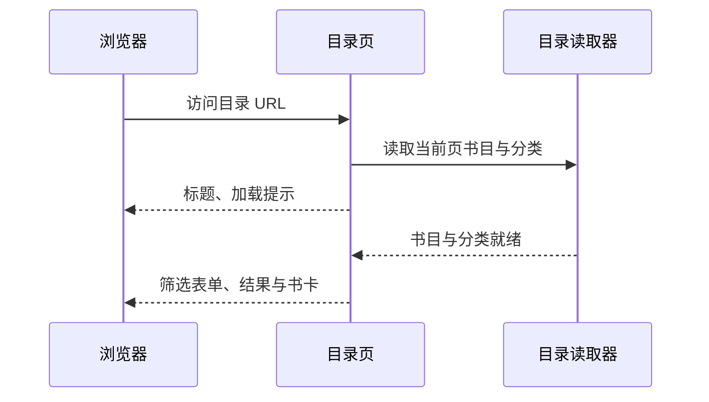

# ADR 0001 应用与工程基线

已接受，2026-10-30。

## 背景

打开目录时，读者需要直接看到书目并进入详情。修改筛选条件、切换主题等操作又依赖浏览器事件。目录的查询规则和组件会随同一个需求一起变化，路由与渲染框架需要容纳这两类代码。

## 决策

Next.js App Router 管理路由、布局、服务端组件和同源 HTTP 入口。页面在服务端读取书目、组合视图，筛选表单接收页面给出的当前条件、选项和文案，再在浏览器中处理提交。目录的模型、组件和链接规则就近放在同一个 feature，页面通过公开入口使用它们。[目录页](<../../src/app/%5Blocale%5D/(store)/books/page.tsx>) · [筛选表单](../../src/features/catalog/ui/catalog-filters.tsx) · [模块组合决策](0003-frontend-module-composition.md)

目录读取较慢时，浏览器可以在同一次页面请求中先收到标题，随后收到书卡。标题位于 `Suspense` 边界外，等待书目和分类的内容位于边界内。生产构建的测试逐块读取 HTML，核对这两部分先后到达。[流式响应用例](../../test/e2e/catalog-journey.spec.ts#L279)

### 工程基线

- TypeScript 启用 strict，Next.js 构建启用 React Compiler。[类型配置](../../tsconfig.json) · [构建配置](../../next.config.ts)
- next-intl 管理语言路由和词典，Tailwind CSS 与 CSS 变量提供样式和主题。Button 和 Input 使用保留许可证的 shadcn/ui 源码，字体来自系统。[样式入口](../../src/app/globals.css) · [组件许可证](../../src/shared/ui/LICENSE.shadcn)
- Node 主版本、包管理器版本和依赖解析都随仓库记录，供本地和持续集成复用。[运行时版本](../../.nvmrc) · [依赖与脚本](../../package.json) · [锁文件](../../pnpm-lock.yaml)

## 取舍

同一个目录 feature 中可以同时出现服务端页面可用的书卡和依赖浏览器事件的表单。由此需要分别检查业务依赖和执行环境。模块规则限制跨 feature 导入，`server-only` 与生产构建约束浏览器依赖链。端到端用例从返回的 HTML 核对首屏书籍链接，再验证导航到详情的行为。[架构约束测试](../../test/unit/architecture.test.ts) · [首屏与详情导航用例](../../test/e2e/catalog-journey.spec.ts#L21)
