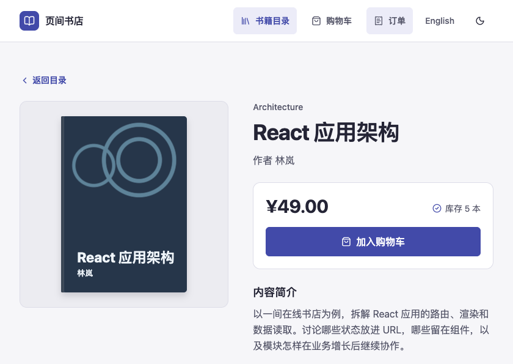
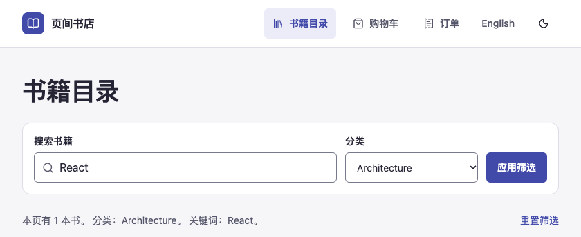

# 目录导航如何保留上下文

读者在英文目录里按分类和关键词找到《React 应用架构》，打开详情，切换到中文，再点「返回目录」。要让直接打开详情链接的人也能回到相同的书目，链接就得带上这次访问的筛选条件。[跨语言返回目录用例](../../test/e2e/catalog-journey.spec.ts#L104)

## 哪些选择进入 URL

输入框保留正在编辑的关键词。提交表单时，`CatalogFilters` 读取表单值、清理首尾空白，生成目录地址并用 `router.push` 发起导航。改变筛选条件会回到第一页。翻页则沿用已提交的分类和关键词。读者按后退时，地址恢复那次导航的筛选条件和页码，页面按对应查询展示书目。[筛选表单](../../src/features/catalog/ui/catalog-filters.tsx) · [目录链接](../../src/features/catalog/ui/links.ts) · [后退与分页用例](../../test/e2e/catalog-journey.spec.ts#L69)

这次访问的查询串是 `?category=Architecture&q=React`。四次导航都带着它。表中的 `{bookId}` 指向同一本书。

| 读者的动作             | 地址中的路径            | 这个链接从哪里来                           |
| ---------------------- | ----------------------- | ------------------------------------------ |
| 在英文目录应用筛选     | `/en/books`             | 表单把已提交的分类和关键词写入地址。       |
| 打开《React 应用架构》 | `/en/books/{bookId}`    | 书卡带上当前查询条件。                     |
| 切换到简体中文         | `/zh-CN/books/{bookId}` | 语言开关替换语言段，保留书籍 ID 和查询串。 |
| 点「返回目录」         | `/zh-CN/books`          | 详情页用当前语言和来源条件重建目录地址。   |

`catalogHref` 省略默认页码。表单也支持原生 GET 提交。清空输入时，浏览器可能提交空的 `q=`，目录页会清理空字段，再用同一个查询模型解析输入。[目录页](<../../src/app/%5Blocale%5D/(store)/books/page.tsx>) · [原生表单用例](../../test/e2e/catalog-keyboard.spec.ts#L90)

## 详情页怎样返回原来的书目

图中页头的「书籍目录」通往中文目录首页，书封上方的「返回目录」则会回到 `/zh-CN/books?category=Architecture&q=React`。详情页校验地址里的 `category`、`q` 和 `page`，缺少来源参数或参数无效时，返回链接指向当前语言的目录首页。详情读取暂时失败时，「重试」仍指向这本书，「返回目录」也保留原筛选。[详情页](<../../src/app/%5Blocale%5D/(store)/books/%5BbookId%5D/page.tsx>) · [语言切换](../../src/app/%5Blocale%5D/language-switch.tsx) · [返回地址的边界用例](../../test/e2e/catalog-journey.spec.ts#L158) · [详情重试用例](../../test/e2e/catalog-journey.spec.ts#L179)

## 结果更新后，键盘用户在哪里

返回后的目录从地址恢复了搜索框、分类和结果摘要。读者也能通过键盘改变这两个条件。

页头的「跳至内容」将焦点交给主内容区。读者可以依次填写关键词、选择分类并提交。筛选完成后，焦点留在提交按钮，继续按 Tab 可到重置链接和第一本书。结果摘要在原有的 `role="status"` 节点中更新，文字同时包含本页的书目数和当前条件。例如，选「全部分类」时，「React」和「Web」都能找到两本书。切换关键词后，摘要里的数量相同，条件文字仍会更新。[跳至内容](../../src/app/%5Blocale%5D/skip-link.tsx) · [结果摘要](<../../src/app/%5Blocale%5D/(store)/books/page.tsx>) · [键盘与状态节点用例](../../test/e2e/catalog-keyboard.spec.ts)

这里的浏览器断言核对地址、焦点、结果文字和 DOM 节点是否复用。实际读屏软件如何播报更新，需要单独评估。
