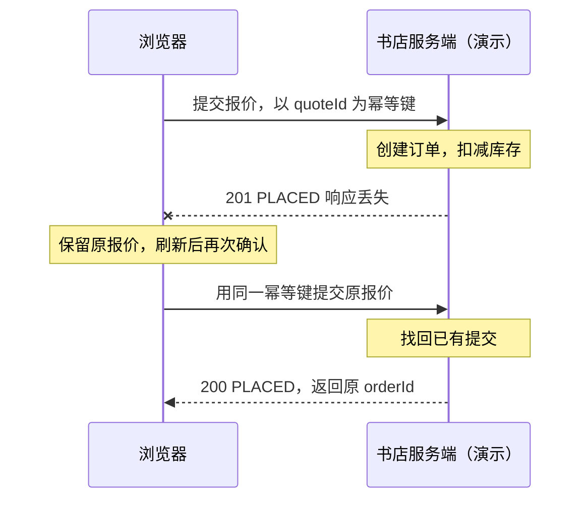
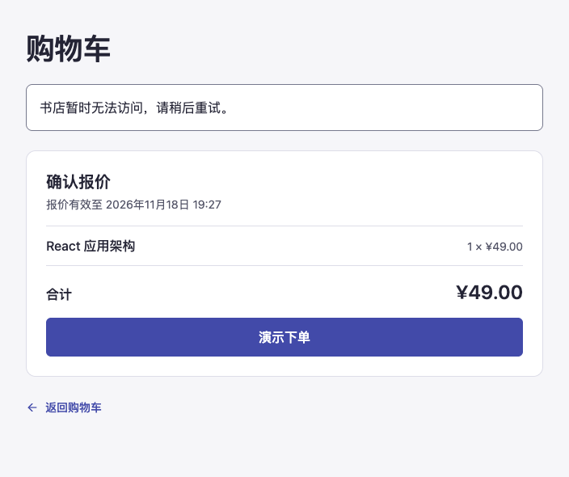

# 浏览器怎样确认一次下单的结果

点击确认后，连接中断。浏览器无法判断请求有没有到达服务端，也无法判断订单是否已经成立。下面是演示模式中订单已经写入、首次响应却丢失的情形。

首次响应丢失时，浏览器尚未收到提交 ID 或订单 ID。确认页的 URL 仍有报价 ID，可用于再次提交。服务端按会话和幂等键找到上次提交。用例核对两次请求的键和正文相同，最终订单只有一笔，库存只减少一本。[演示提交实现](../../src/server/adapters/demo/checkout.server.ts) · [丢响应重试用例](../../test/e2e/bookstore-checkout.spec.ts#L387)

## 一次交易中的三个 ID

| 标识           | 作用                                         | 浏览器何时使用                                                            |
| -------------- | -------------------------------------------- | ------------------------------------------------------------------------- |
| `quoteId`      | 标识读者确认的报价快照，也是书店选用的幂等键 | 确认页通过 URL 找回报价。每次提交同一报价都发送相同的 `Idempotency-Key`。 |
| `submissionId` | 标识一次下单提交，处理过程可以持续多个请求   | 提交响应返回该 ID。仍在处理时，用它查询同源状态资源。                     |
| `orderId`      | 标识实际成立的订单                           | 收到带订单 ID 的 `PLACED` 后进入订单页，订单页再按当前会话读取记录。      |

购物车条目的 `ETag` 解决另一个问题。一个标签页把数量从一改到二后，另一个标签页用旧版本提交更新会收到 `412`。页面重新读取购物车，读者看到当前数量后再决定怎么改。生成报价时带上所选币种和该币种分组的 `cartRevision`，把读者看到的那组商品与报价关联起来。[跨标签页用例](../../test/e2e/bookstore-checkout.spec.ts#L62) · [报价请求](../../src/features/checkout/api.ts)

## 类型正确的请求也可能收到无效响应

创建报价、提交订单和查询提交状态使用 BFF 的 OpenAPI 生成类型。它能在开发时检查路径、参数和请求体。返回给浏览器的 JSON 还有一道运行时校验。例如 `PLACED` 必须含有效的 `orderId`，轮询收到的 `submissionId` 必须与正在查询的 ID 一致。[BFF 契约](../../contracts/bff/v1.yaml) · [提交状态模型](../../src/features/checkout/model.ts)

创建报价时，客户端要求 `Location` 与正文中的报价 ID 对应。提交响应带有 `Location` 时，客户端也核对它与提交 ID 是否匹配。地址不一致、JSON 无法解析或单次请求超过八秒，都会使本次结果无法确认。若错误发生在提交或随后的轮询阶段，表单保留原报价，允许再次确认。[请求实现](../../src/features/checkout/api.ts) · [错误响应与超时用例](../../test/e2e/checkout-transport.spec.ts)

## 用户接下来能做什么

| 可观察到的结果                    | 页面行为                                                                   |
| --------------------------------- | -------------------------------------------------------------------------- |
| 提交时连接中断，未收到结果        | 提示稍后重试并显示原报价，读者可以再次确认。                               |
| `PROCESSING`                      | 有限次数地查询同一提交。用尽轮询次数后提示仍在处理，保留原报价供手动重查。 |
| `RECONCILE_REQUIRED`              | 提示等待核对，保留原报价。自动轮询至此停止。                               |
| `UNAUTHENTICATED`                 | 提交或轮询时保留报价 ID。发布模式引导读者登录，回到同一报价后手动继续。    |
| `QUOTE_EXPIRED` 或终态 `REJECTED` | 展示报价过期、价格变化或库存不足等对应反馈，让读者回到购物车重新核对。     |
| `PLACED` 且带有效订单 ID          | 跳转到订单页查看结果。                                                     |

图中是演示订单已写入、浏览器丢失首次响应时的确认页。再次点击「演示下单」会带上同一报价 ID。

`202` 告知浏览器提交已受理，下一步由响应中的状态决定。页面根据业务码选择中英文文案。创建或读取报价、提交资源遇到 5xx 时，可用错误响应中的 `requestId` 找到这一次请求的服务端日志。查询交易结果则使用 `submissionId`。[结算表单](../../src/features/checkout/ui/checkout-form.tsx) · [结算日志用例](../../test/unit/checkout-observability.test.ts)

演示模式实际同步落单，测试用可控响应覆盖不同轮询结果。发布联调验证实际的提交状态查询、重新登录和购物车版本清理。两组用例分别验证浏览器的判断和跨服务的结果。[演示模式用例](../../test/e2e/bookstore-checkout.spec.ts) · [发布联调](../../test/live-java/checkout.spec.ts)
