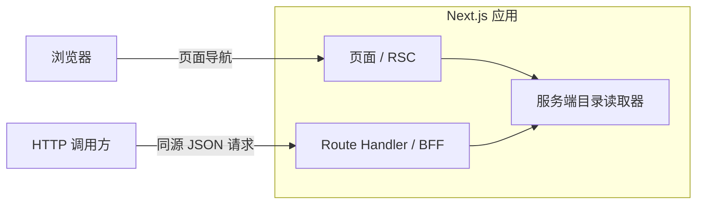

# 前端架构概览

应用以 Next.js App Router 为外壳，按业务功能划分模块。以书籍目录为例，路由负责组织页面和入口，目录模块持有查询模型和交互组件，服务端读取器统一处理数据读取与公开读缓存。筛选表单、查询规则和目录展示归在同一个 feature，便于一处查阅同一功能的代码。

本地 demo 的加购、购物车更新和结算走 BFF 的资源接口。请求用 HttpOnly Cookie 识别浏览器，同源校验通过后才写 SQLite。详情页加购用条目的 `ETag` 做有条件的 `PUT`，避免同一购物车的并发写入覆盖数量。结算从购物车生成有期限的报价，再以报价和幂等键提交。提交记录、库存扣减、订单快照与购物车清理在同一事务写入，随后公开目录缓存重新读取库存。购物车、报价、提交和订单记录按浏览器读取，响应采用 `Cache-Control: no-store`。[本地购书接口](architecture-spec.md#本地购书接口)

Java v2 集成用 Keycloak 建立账户会话。公开目录从 Java Catalog 读取，私有订单按客户 JWT 访问 Java Order。BFF PostgreSQL 保存购物车草稿和报价与草稿行版本的关联。提交进入 `PLACED` 后，BFF 仅删除版本仍与报价一致的行。失败和处理中状态保留草稿。[Java 集成 ADR](../adr/0004-java-integrated-checkout.md)

## 页面与同源 HTTP 接口

箭头表示运行时调用。页面在 Next.js 进程内直接调用 `readCatalog` 或 `readBook` 获取渲染数据。Route Handler 作为 BFF（Backend for Frontend），面向 HTTP 调用方校验输入、选择语言、组织 JSON 和状态码。两条路径复用目录模型和读取策略。[目录读取器](../../src/server/catalog.server.ts) · [目录 Route Handler](../../src/app/api/v1/catalog/books/route.ts)

## 模块与执行环境

| 模块       | 职责                                                      |
| ---------- | --------------------------------------------------------- |
| `app`      | 路由、布局、页面组合、加载与错误边界以及同源 HTTP 入口。  |
| `features` | 按业务功能收纳界面、可独立执行的校验逻辑和公开入口。      |
| `server`   | 服务端读取、缓存、运行配置和模块装配。                    |
| `shared`   | 可复用的基础组件、样式工具和传输类型。                    |
| `i18n`     | 语言路由与请求语言，翻译资源由根目录的 `messages/` 提供。 |

模块职责与组件运行环境各自独立。`features/catalog` 里既有校验查询参数的纯模型，也有带 `'use client'` 的筛选表单。页面通过公开入口组合这些能力。数据读取和服务端配置留在由 `server-only` 标记的依赖链上。[目录模型](../../src/features/catalog/model.ts) · [筛选表单](../../src/features/catalog/ui/catalog-filters.tsx) · [依赖规则](architecture-spec.md#公开入口与依赖方向)

## 渲染与状态归属

SSR 描述 HTML 在哪里生成。React Server Component（RSC）描述组件在哪个环境执行。目录页在 `Suspense` 内通过 `connection()` 划出请求时渲染的部分。标题和加载提示可随静态外壳先发出，目录内容在读取请求参数和结果后渲染。筛选表单的 HTML 可随页面发出，由浏览器激活提交和导航交互。[目录页面](<../../src/app/%5Blocale%5D/(store)/books/page.tsx>) · [Next.js 服务端与客户端组件](https://nextjs.org/docs/app/getting-started/server-and-client-components)

| 数据或状态             | 所有者                                                            | 代码入口                                                                                 |
| ---------------------- | ----------------------------------------------------------------- | ---------------------------------------------------------------------------------------- |
| 页面语言               | URL 路径中的 `[locale]`。布局据此选择词典并设置文档语言。         | [语言路由](../../src/i18n/routing.ts) · [布局](../../src/app/%5Blocale%5D/layout.tsx)    |
| 已提交的筛选条件和页码 | URL 查询字符串。直接访问、刷新和后退都以 URL 为准。               | [目录链接](../../src/features/catalog/ui/links.ts)                                       |
| 尚未提交的筛选输入     | 表单自身。应用筛选时改写 URL 并回到第一页。                       | [筛选表单](../../src/features/catalog/ui/catalog-filters.tsx)                            |
| 目录结果与详情         | 服务端读取器。常用的公开结果可由页面和 BFF 复用。                 | [公开读取与缓存 ADR](../adr/0002-public-reads-and-cache.md)                              |
| 主题选择               | 浏览器 `localStorage`。通过文档根节点的 `data-theme` 切换语义色。 | [主题开关](../../src/shared/ui/theme-switch.tsx) · [全局样式](../../src/app/globals.css) |
