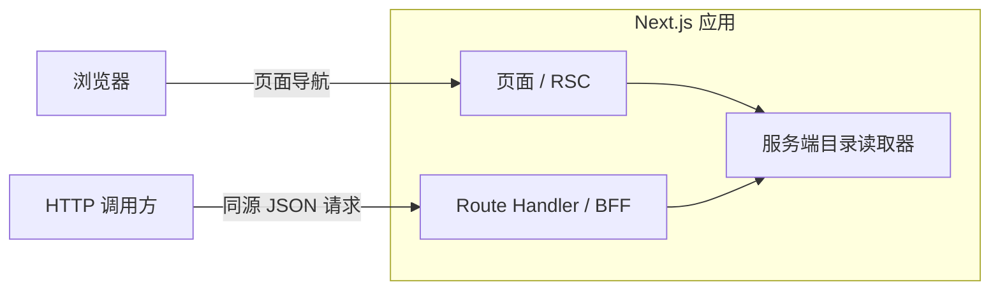

# 前端架构概览

应用以 Next.js App Router 为外壳，按业务功能划分模块。以书籍目录为例，路由负责组织页面和入口，目录模块持有查询模型和交互组件，服务端读取器统一处理数据读取与公开读缓存。筛选表单、查询规则和目录展示归在同一个 feature，便于一处查阅同一功能的代码。

本地 demo 的加购、购物车更新和结算走 BFF 的资源接口。请求用 HttpOnly Cookie 识别浏览器，同源校验通过后才写 SQLite。详情页加购用条目的 `ETag` 做有条件的 `PUT`，避免同一购物车的并发写入覆盖数量。结算从购物车生成有期限的报价，再以报价和幂等键提交。提交记录、库存扣减、订单快照与购物车清理在同一事务写入，随后公开目录缓存重新读取库存。购物车、报价、提交和订单记录按浏览器读取，响应采用 `Cache-Control: no-store`。[本地购书接口](architecture-spec.md#本地购书接口)

发布模式接入 Java v1，用 Keycloak 建立账户会话。公开目录从 Java Catalog 读取，私有订单按客户 JWT 访问 Java Order。BFF PostgreSQL 保存购物车草稿和报价与草稿行版本的关联。提交进入 `PLACED` 后，BFF 仅删除版本仍与报价一致的行。失败和处理中状态保留草稿。[Java 集成 ADR](../adr/0004-java-integrated-checkout.md)

## 页面首屏与独立 HTTP 调用

目录页在 `Suspense` 内直接调用服务端读取器，慢请求期间可先发送标题和加载提示。独立 HTTP 调用方通过同源 Route Handler 获取 JSON，路由负责校验输入、选择语言和返回状态码。两个入口共用读取器。生产用例核对筛选后的页面与 JSON 书目一致，并在 Release 目录替身延迟时观察到页面外壳先到。[目录页](<../../src/app/%5Blocale%5D/(store)/books/page.tsx>) · [目录接口](../../src/app/api/v1/catalog/books/route.ts) · [书目一致用例](../../test/e2e/catalog-journey.spec.ts#L53) · [流式用例](../../test/e2e/catalog-journey.spec.ts#L279)

只有页面消费数据时，RSC 在进程内读取即可。有独立 HTTP 调用方或浏览器需要脱离页面导航刷新数据时，Route Handler 提供独立的接口契约。目录读取器把后端选择与页面和 HTTP 入口隔开。[双数据源与公开缓存](../adr/0002-public-reads-and-cache.md)

## 模块与执行环境

| 模块       | 职责                                                      |
| ---------- | --------------------------------------------------------- |
| `app`      | 路由、布局、页面组合、加载与错误边界以及同源 HTTP 入口。  |
| `features` | 按业务功能收纳界面、可独立执行的校验逻辑和公开入口。      |
| `server`   | 服务端读取、缓存、运行配置和模块装配。                    |
| `shared`   | 可复用的基础组件、样式工具和传输类型。                    |
| `i18n`     | 语言路由与请求语言，翻译资源由根目录的 `messages/` 提供。 |

模块职责与组件运行环境各自独立。`features/catalog` 里既有校验查询参数的纯模型，也有带 `'use client'` 的筛选表单。页面通过公开入口组合这些能力。数据读取和服务端配置留在由 `server-only` 标记的依赖链上。购物车页通过公开入口组合目录书封与结算操作，两个 feature 各自维护业务逻辑。[购物车页](<../../src/app/%5Blocale%5D/(store)/cart/page.tsx>) · [跨 feature 组合 ADR](../adr/0003-frontend-module-composition.md) · [依赖规则](architecture-spec.md#公开入口与依赖方向)

## 渲染与状态归属

目录筛选需要支持分享和后退，报价确认需要在刷新后恢复，同时保护当前会话的交易数据。目录的已提交筛选与页码由 URL 恢复，输入留在表单直到提交。确认页从报价 ID 恢复服务端的报价。现有用例覆盖筛选导航和报价资源的会话隔离。[筛选导航用例](../../test/e2e/catalog-journey.spec.ts#L69) · [交易资源隔离用例](../../test/e2e/bookstore-checkout-http.spec.ts)

| 数据或状态             | 所有者                                                                                          | 代码入口                                                                                                                        |
| ---------------------- | ----------------------------------------------------------------------------------------------- | ------------------------------------------------------------------------------------------------------------------------------- |
| 页面语言               | URL 路径中的 `[locale]`。布局据此选择词典并设置文档语言。                                       | [语言路由](../../src/i18n/routing.ts) · [布局](../../src/app/%5Blocale%5D/layout.tsx)                                           |
| 已提交的筛选条件和页码 | URL 查询字符串。直接访问、刷新和后退都以 URL 为准。                                             | [目录链接](../../src/features/catalog/ui/links.ts)                                                                              |
| 尚未提交的筛选输入     | 表单自身。应用筛选时改写 URL 并回到第一页。                                                     | [筛选表单](../../src/features/catalog/ui/catalog-filters.tsx)                                                                   |
| 目录结果与详情         | 服务端读取器。页面与 BFF 共用读取逻辑，演示模式可缓存常用结果。                                 | [公开读取与缓存 ADR](../adr/0002-public-reads-and-cache.md)                                                                     |
| 购物车                 | Demo 按浏览器会话保存在 SQLite，Release 按账户保存在 BFF PostgreSQL。                           | [购物车页](<../../src/app/%5Blocale%5D/(store)/cart/page.tsx>)                                                                  |
| 报价与订单提交         | 报价 URL 只持有 ID。服务端按当前会话读取，Demo 由 SQLite 持有交易，Release 由 Java Order 持有。 | [报价接口](../../src/app/api/v1/order-quotes/%5BquoteId%5D/route.ts) · [Java 结算 ADR](../adr/0004-java-integrated-checkout.md) |
| 主题选择               | 浏览器 `localStorage`。通过文档根节点的 `data-theme` 切换语义色。                               | [主题开关](../../src/shared/ui/theme-switch.tsx) · [全局样式](../../src/app/globals.css)                                        |

只有多个客户端视图需要共享远端数据并协调刷新时，才评估客户端查询缓存。需要跨区域编辑同一份未提交草稿时，可使用本地共享状态。

## 并发写入与异步结算

不同标签页可能同时写购物车，订单写入后浏览器也可能收不到提交响应。条目的 `ETag` 表示当前版本，`If-Match` 带回该版本。收到 `412` 时，页面提示核对最新数量。报价固定此次交易输入，提交使用报价 ID 作为稳定的幂等键，响应的 `Location` 指向可独立查询的提交资源。[条目接口](../../src/app/api/v1/cart/items/%5BbookId%5D/route.ts) · [提交接口](../../src/app/api/v1/order-submissions/route.ts) · [跨标签页冲突用例](../../test/e2e/bookstore-checkout.spec.ts#L62) · [幂等重放用例](../../test/e2e/bookstore-checkout-http.spec.ts)

Release 的 `202` 表示提交已受理，结果仍待确认。只有 `PROCESSING` 触发有限轮询，`RECONCILE_REQUIRED` 提示等待核对并可手动重查。成功以 `PLACED` 且有订单 ID 为准。Demo 的浏览器用例用模拟的 `202` 验证轮询，实际订单由 SQLite 同步提交。[结算交互](../../src/features/checkout/ui/checkout-form.tsx) · [Demo 模拟轮询用例](../../test/e2e/bookstore-checkout.spec.ts#L153) · [真实 Java 支撑的 BFF 用例](../../test/live-java/checkout.spec.ts#L388)

提交或轮询失去认证时保留报价 ID。Release 让用户重新登录并回到原报价，再用同一幂等键手动继续确认。已经受理的提交可以在报价到期后重放。联调用例只模拟触发恢复的操作 401，随后走真实 Keycloak 回跳和 Java 下单。[登录恢复用例](../../test/live-java/checkout.spec.ts#L388) · [报价到期后重放用例](../../test/integration/demo-checkout.test.ts#L85)

仅由本站表单发起且无需独立 HTTP 契约的单次写入可用 Server Action。书店用同源 BFF 表达版本冲突、幂等重放和提交状态查询。[BFF 契约](../../contracts/bff/v1.yaml)
