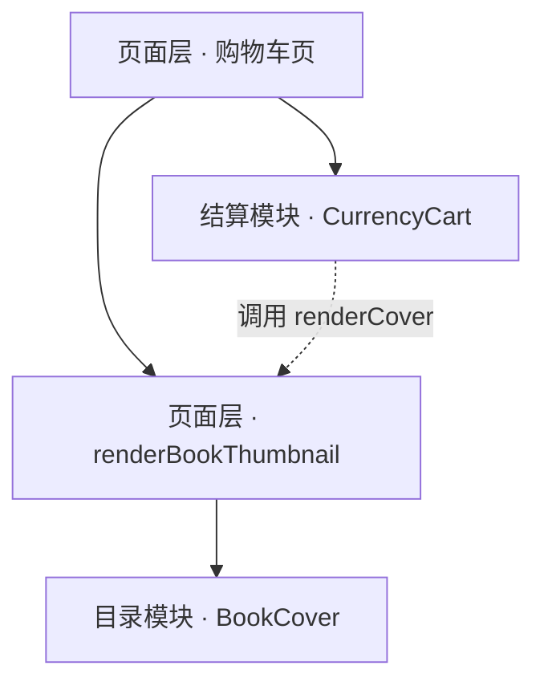

# 前端架构概览

书店按业务组织代码，再按执行环境分配职责。前者决定目录和结算可以各自修改哪些代码，后者决定哪些工作适合在请求到来时完成、哪些工作需要响应浏览器事件。两种划分会出现在同一个功能里。目录模块既有服务端页面可用的书卡，也有需要处理用户输入的筛选表单。[架构总图](../../README.md#架构总图)

## 业务模块与页面组合

修改目录筛选时，查询规则、生成链接的函数和筛选表单通常一起变化，因此放在 `features/catalog`。报价模型、购物车视图和结算交互归 `features/checkout`。路由知道当前页面需要哪些功能，通过各自的公开入口组装它们。[目录模块](../../src/features/catalog/) · [结算模块](../../src/features/checkout/)

购物车的每一行都要显示书封。购物车页把 `renderBookThumbnail` 作为 `renderCover` 属性传给结算视图。图中实线指向导入的代码，虚线表示渲染时通过属性调用函数。

改书封样式时，改动集中在目录模块。调整数量与金额时，改动集中在结算模块。两个模块的组合关系由购物车页维护。[购物车页](<../../src/app/%5Blocale%5D/(store)/cart/page.tsx>) · [书封组合](<../../src/app/%5Blocale%5D/(store)/book-thumbnail.tsx>) · [依赖规则](architecture-spec.md#公开入口与依赖方向)

## 服务端渲染与客户端交互

打开目录时，标题和书目对数据的依赖不同。`BooksPage` 先给出标题和加载提示，把等待书目的 `CatalogContent` 放在 `Suspense` 中。结果就绪后，服务端再发出书卡。即使目录读取较慢，读者也能先看到页面外壳。[目录页](<../../src/app/%5Blocale%5D/(store)/books/page.tsx>) · [流式响应用例](../../test/e2e/catalog-journey.spec.ts#L279)

筛选需要响应浏览器里的表单提交。页面把选项、当前查询和本地化文案作为属性传给 `CatalogFilters`。该组件用 `'use client'` 声明交互边界，从表单生成新 URL 并触发导航。下一页仍由服务端读取书目。这让事件处理靠近表单，数据源和服务凭据留在服务端。[筛选表单](../../src/features/catalog/ui/catalog-filters.tsx) · [目录读取器](../../src/server/catalog.server.ts)

同一个 feature 可以同时提供纯模型、客户端可用的组件和服务端视图。`client.ts` 是允许浏览器依赖的公开入口，具体文件的 `'use client'` 决定客户端组件边界。`server-only` 保护服务端依赖链。[模块组合决策](../adr/0003-frontend-module-composition.md)

## 状态归属与恢复

判断状态放在哪里，可以先问：谁需要恢复它？读者把目录链接发给别人，对方应看到同一组筛选。读者把报价链接发给别人，对方却不能读取这笔交易。目录地址保存了重建查询所需的条件，报价地址只保存标识，服务端仍按当前会话查找报价。[目录导航如何保留上下文](catalog-navigation.md) · [报价刷新用例](../../test/e2e/bookstore-checkout.spec.ts#L210) · [交易资源隔离用例](../../test/e2e/bookstore-checkout-http.spec.ts#L129)

| 数据或状态             | 所有者                                                              | 代码入口                                                                                                                                              |
| ---------------------- | ------------------------------------------------------------------- | ----------------------------------------------------------------------------------------------------------------------------------------------------- |
| 页面语言               | URL 路径中的 `[locale]`。布局据此选择词典并设置文档语言。           | [语言路由](../../src/i18n/routing.ts) · [布局](../../src/app/%5Blocale%5D/layout.tsx)                                                                 |
| 已提交的筛选条件和页码 | URL 查询字符串。直接访问、刷新和后退都以 URL 为准。                 | [目录链接](../../src/features/catalog/ui/links.ts)                                                                                                    |
| 尚未提交的筛选输入     | 表单自身。应用筛选时改写 URL 并回到第一页。                         | [筛选表单](../../src/features/catalog/ui/catalog-filters.tsx)                                                                                         |
| 目录结果与详情         | 目录数据源。页面与 BFF 通过同一读取器取数，演示模式可缓存公开结果。 | [公开读取与缓存 ADR](../adr/0002-public-reads-and-cache.md)                                                                                           |
| 购物车                 | 服务端。演示按浏览器会话隔离，发布按登录账户隔离。                  | [购物车页](<../../src/app/%5Blocale%5D/(store)/cart/page.tsx>)                                                                                        |
| 报价与订单提交         | 服务端。确认页用报价 ID 恢复报价，提交结果可通过同源状态接口读取。  | [报价接口](../../src/app/api/v1/order-quotes/%5BquoteId%5D/route.ts) · [状态接口](../../src/app/api/v1/order-submissions/%5BsubmissionId%5D/route.ts) |
| 主题选择               | 浏览器 `localStorage`。通过文档根节点的 `data-theme` 切换语义色。   | [主题开关](../../src/shared/ui/theme-switch.tsx) · [全局样式](../../src/app/globals.css)                                                              |

只有多个客户端视图需要共享远端数据并协调刷新时，才评估客户端查询缓存。需要跨区域编辑同一份未提交草稿时，可使用本地共享状态。

## 页面首屏与独立 HTTP 调用

目录页已经在服务端执行，可以直接调用 `readCatalog`。需要独立 JSON 响应的调用方走同源 Route Handler，由它处理 HTTP 参数、语言和状态码。两个入口共用查询模型和读取器，一处调整书目选择规则即可作用于两条路径。[目录页](<../../src/app/%5Blocale%5D/(store)/books/page.tsx>) · [目录接口](../../src/app/api/v1/catalog/books/route.ts) · [页面与 JSON 书目一致用例](../../test/e2e/catalog-journey.spec.ts#L53)

数据源的选择也在读取器内完成。演示模式下，常用的公开列表和详情可以复用服务端缓存，自由文本查询直接读取。发布模式每次读当前目录，以反映最新库存。两种模式提供同一套页面和 HTTP 契约。HTTP 响应的 `no-store` 与读取器内部的缓存分别作用于不同边界。[目录端口](../../src/features/catalog/server.ts) · [服务端装配](../../src/server/catalog.server.ts) · [公开读取与缓存决策](../adr/0002-public-reads-and-cache.md)

## 并发写入与异步结算

在两个标签页里打开购物车，后提交的页面可能还显示旧数量。更新或删除时，浏览器用 `If-Match` 交回读到的条目版本，旧版本会得到 `412`。报价保护的范围更大：创建报价时，服务端检查所选币种下整组条目的版本。发布模式还记下参与报价的每一行，成交时只清除版本依旧匹配的条目。[跨标签页冲突用例](../../test/e2e/bookstore-checkout.spec.ts#L62) · [报价后又改了购物车会怎样](../adr/0004-java-integrated-checkout.md)

订单已写入而响应丢失时，版本检查不能回答「这笔订单成立了吗」。书店以报价 ID 为幂等键，重试同一报价可以取回提交结果。若提交仍在处理，浏览器可查询独立的状态资源，等到收到订单 ID 再进入订单页。本站表单的一次性写入可用 Server Action。这里的条件请求、幂等重放与状态查询共同构成了需要独立维护的 HTTP 接口。[浏览器怎样确认一次下单的结果](checkout-contract.md) · [BFF 契约](../../contracts/bff/v1.yaml)

## 从筛选书目到确认订单

| 读者操作   | 浏览器带给下一步的数据                                           | 页面或交易如何恢复                                                                                                                                           |
| ---------- | ---------------------------------------------------------------- | ------------------------------------------------------------------------------------------------------------------------------------------------------------ |
| 应用筛选   | 将分类、关键词写入目录 URL，回到第一页。                         | 后退或直接打开链接时，页面按地址中的查询重新展示书目。[筛选导航用例](../../test/e2e/catalog-journey.spec.ts#L69)                                             |
| 加入购物车 | 按书籍 ID 写入数量，成功后导航到购物车。                         | 购物车页按当前会话读取草稿，刷新后仍能看到保存的条目。[购物车页](<../../src/app/%5Blocale%5D/(store)/cart/page.tsx>)                                         |
| 创建报价   | 提交所选币种和该组购物车的版本，将返回的报价 ID 放入确认页 URL。 | 刷新确认页时，服务端按会话和报价 ID 读回同一份报价。[交易请求](../../src/features/checkout/api.ts)                                                           |
| 确认下单   | 提交报价 ID，同时用它作为幂等键。                                | 响应丢失后用同一键再次确认，可取回已成立的订单。演示用例核对只生成一笔订单、只扣一次库存。[丢响应后重试用例](../../test/e2e/bookstore-checkout.spec.ts#L387) |
