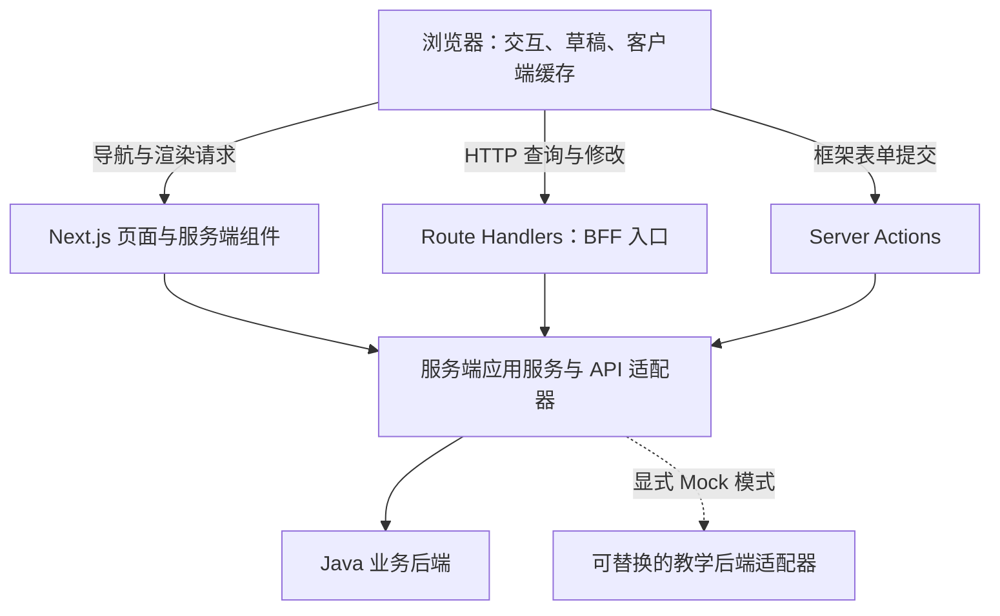

# 现代 React 应用参考架构：建设指导书

版本：2.0  
日期：2026-10-30  
状态：架构与技术方向已确认，尚未实施及验证依赖兼容性  
业务案例：在线书店  
建议仓库名：`react-reference-architecture`

## 1. 项目定位与交付目标

通过一个完整、可运行、可测试的在线书店，整合现代 React 服务端与客户端架构、主流技术组件及工程实践，为学习架构和搭建新项目提供参照。

项目是一套架构参考实现。教学围绕系统职责、模块边界、技术协作、业务数据流和设计取舍展开，不编排为逐项讲解组件 API 的课程。完整性体现为架构能力与业务流程闭环，不要求每个库的每项功能都建立独立案例。

与现有 [explicit-architecture](https://github.com/ansonli-dev/explicit-architecture) 后端实例共用在线书店语境：Java 后端展示业务规则、事务和系统集成；本项目展示浏览器、Next.js 服务端、BFF 与业务后端如何组成完整应用。前后端通过契约连接，不要求目录和领域模型一一对应。

交付完整实例及其架构文档，不单独交付最小启动模板。读者应能理解系统如何组织，并知道新需求放在哪里、如何贯通及验证。

### 1.1 六个架构主题

| 主题               | 应回答的问题                                             |
| ------------------ | -------------------------------------------------------- |
| 系统全貌与职责划分 | 浏览器、Next.js 服务端、BFF、Java 后端各负责什么         |
| 代码组织与依赖边界 | 路由、业务模块、共享组件和服务端能力如何组织             |
| 渲染、数据与状态   | 哪些在服务端执行，哪些在客户端；数据如何获取、缓存和更新 |
| 组件与业务流程     | UI、表单、业务规则如何分工并组成完整用户旅程             |
| 横切能力           | 认证、权限、国际化、错误处理及可观测性如何统一接入       |
| 工程与交付         | 如何测试、约束架构、持续集成、构建和部署                 |

### 1.2 范围与原则

- 将 SSR、React Server Components（RSC）、客户端交互、静态生成、再验证、流式渲染和 BFF 纳入同一应用架构。
- 同类问题给出一个默认做法；替代技术和演进方案通过 ADR 说明，不在主流程并列堆叠。
- 以少量完整业务流程承载能力；安全、性能和可访问性作为工程基线与验收要求。
- 简单场景保持直接，复杂场景才提取编排；不机械移植后端聚合、总线或依赖注入体系。
- 不涉及真实支付、复杂促销、推荐算法、微前端或通用工作流平台。示例推荐区可用固定教学数据。
- NestJS 独立 BFF 保留为架构演进专题，不扩展为第二套后端课程，不作为主流程启动依赖。

## 2. 总体架构

### 2.1 架构主线

采用 **按业务功能组织的模块化架构（Feature-based Modular Architecture）+ Next.js App Router 的服务端/客户端边界**。Bulletproof React 用作模块化和工程实践参照，具体目录及依赖规则由本仓库 ADR 定义。

FSD、Clean / Hexagonal 和 Presentation Model 用于解释边界和取舍，不在项目中同时执行多套目录体系。Next.js 的路由目录是应用入口，不是所有业务逻辑的容器。



图表示运行关系。服务端组件直接调用服务端应用服务，不绕行请求本应用的 Route Handler。浏览器通过同源 BFF 访问需要会话和后端适配的业务接口。

### 2.2 职责边界

| 部分                     | 负责                                         | 边界                                             |
| ------------------------ | -------------------------------------------- | ------------------------------------------------ |
| 浏览器                   | 交互、表单、草稿、客户端缓存                 | 不持有服务端秘密，不决定最终价格、库存和业务权限 |
| Next.js 页面与服务端组件 | 路由、页面组合、服务端取数与渲染             | 不重复实现后端业务不变量                         |
| BFF / 服务端应用服务     | 会话适配、页面数据聚合、传输转换、错误归一化 | 不演变为第二套订单、库存领域服务                 |
| Java 后端                | 权威业务规则、授权、事务、持久化及集成       | 前端输入和身份传递仍需验证                       |

Server Actions 与 Route Handlers 都是需要认证、授权和输入验证的服务端入口。隐藏按钮或将代码放在服务端不能替代权限控制。

## 3. 技术基线与职责分工

采用当前受支持的稳定版本，搭建时核验 Next.js、React、TypeScript、Node 及相关插件的兼容关系，记录准确版本并提交 lockfile。分别使用最新版本不代表组合已兼容；本指导书不声明未经安装验证的版本组合已通过测试。

| 领域             | 默认选择                                           | 在本项目中的职责                                                |
| ---------------- | -------------------------------------------------- | --------------------------------------------------------------- |
| 应用框架         | Next.js App Router                                 | 路由、布局、渲染、Server Actions、Route Handlers、构建与运行    |
| UI / 语言        | React + TypeScript strict                          | 组件、交互与类型边界                                            |
| 编译优化         | React Compiler                                     | 按框架支持方式启用，验证兼容，不到处预先添加手工 memo           |
| 运行与依赖       | 受支持的 Node.js LTS + pnpm                        | 固定运行环境与包管理器版本                                      |
| 样式             | Tailwind CSS + CSS 主题变量                        | 布局、响应式、主题、暗色模式；必要时补充普通 CSS                |
| 组件             | shadcn/ui + Lucide 图标                            | 通用交互组件与可维护的组件源码                                  |
| 表单与校验       | React Hook Form + Zod                              | 客户端表单生命周期；明确的输入、配置和持久化边界                |
| 客户端服务端状态 | TanStack Query                                     | 客户端交互查询、缓存、刷新及修改状态                            |
| 客户端共享状态   | Zustand                                            | 跨页面草稿、持久化与迁移                                        |
| 表格             | TanStack Table                                     | 管理场景的排序、筛选、分页和选择；UI 使用 shadcn 组合           |
| 大列表           | TanStack Virtual                                   | 在扩展管理场景中展示虚拟化及适用条件                            |
| API 契约与客户端 | OpenAPI + openapi-typescript + openapi-fetch       | 传输类型生成、类型安全请求与错误适配                            |
| 国际化           | next-intl                                          | 语言路由、服务端与客户端文案                                    |
| 身份认证         | OIDC/OAuth 2.0 + 成熟 Next.js 认证集成库           | 服务端会话、登录退出和身份传递；库及身份提供方在接入 ADR 中确定 |
| Mock             | MSW + 可替换服务端 API 适配器                      | 浏览器/Node 测试模拟，以及独立运行的服务端教学数据              |
| 组件文档         | Storybook                                          | 代表性共享组件和业务组件的状态与交互                            |
| 测试             | Vitest + React Testing Library + Playwright        | 纯逻辑、组件、服务端集成和用户旅程                              |
| 工程约束         | ESLint flat config + Prettier + dependency-cruiser | 代码一致性、模块边界及循环依赖                                  |
| 可观测性         | OpenTelemetry + 结构化日志                         | 页面服务、BFF 与后端请求关联；浏览器采集按需要接入              |
| CI / 部署        | GitHub Actions + Node/Docker 示例                  | 持续检查、生产构建、运行配置与部署                              |

### 3.1 避免职责重叠

- 主应用由 Next.js 提供路由、构建与渲染，不再叠加 React Router 或 Vite。Storybook/Vitest 自身所需的工具链不属于第二套应用架构。
- Tailwind 与 shadcn/ui 构成统一 UI 体系，不同时引入 Ant Design。纳入仓库的组件源码需要维护和回归检查。
- React Hook Form 管表单，Zustand 管少量跨页业务草稿，Query 管客户端远程数据；不重复存放同一份状态。
- 服务端页面取数不必全部接入 Query。需要客户端持续交互时，再显式预取/hydrate 或由客户端查询；避免初次展示重复请求。
- Server Actions 和 BFF mutation 各自选择有代表性的业务场景，共用服务端应用服务，不为同一操作实现两套等价业务逻辑。
- Zod 的前端校验用于反馈和边界防护，服务端入口和业务后端仍独立验证；生成 TypeScript 类型不提供运行时验证。

### 3.2 替代方案的教学位置

| 方案                | 在本仓库中的位置                                            |
| ------------------- | ----------------------------------------------------------- |
| Vite + React Router | ADR 中解释纯 SPA 的适用场景，不维护第二个完整应用           |
| Ant Design          | ADR 中对照完整组件库与源码组件体系的取舍                    |
| NestJS 独立 BFF     | 后续演进专题：展示独立发布、聚合及会话边界，与内置 BFF 对照 |
| FSD                 | 对照模块组织方式，不混用两套层次命名                        |

## 4. 代码组织与依赖约束

以下是目标骨架，按实际需求创建目录，不预先生成大量空层。主应用先保持单项目；独立 NestJS BFF 专题实施时，再依据实际需要调整为 workspace。

```text
src/
  app/                        # Next.js 路由、layout、page、边界及薄入口
    [locale]/
      (store)/
      (account)/
      (admin)/
    api/                      # Route Handlers
  features/
    catalog/
    cart/
    checkout/
    orders/
    book-management/
  server/                     # 跨模块服务端编排、会话、后端接入与依赖装配
  shared/
    ui/                       # shadcn 基础及稳定通用组件
    api/                      # 契约、生成类型、通用传输类型
    config/
    lib/
  i18n/                       # next-intl 配置与资源
  mocks/                      # handlers、场景、服务端替代适配器及数据工厂
  testing/                    # 测试 Provider 与辅助工具
public/
docs/
```

业务模块内部按需组织 `components/`、`hooks/`、`model/`、`api/` 和 `server/`。模块业务逻辑仍归模块，根 `server/` 只放跨模块服务端能力与装配，不成为全局业务 services 堆积区。

### 4.1 两类边界同时约束

| 边界     | 规则                                                                                           |
| -------- | ---------------------------------------------------------------------------------------------- |
| 业务边界 | app/server 装配层通过公开入口组合模块；feature 默认不直接依赖其他 feature，稳定例外经 ADR 明确 |
| 基础依赖 | shared 不依赖 features、app 或 server；纯 model 不依赖 React、DOM、HTTP 和框架设施             |
| 执行环境 | 含秘密、会话或后端调用的模块使用 `server-only`；客户端代码不得导入该依赖链                     |
| 模块出口 | 区分客户端安全入口、服务端入口和纯类型入口，避免单一 barrel 意外混合执行环境                   |
| 页面职责 | 路由文件处理入口和组合，业务规则不堆在 page、route 或 action 中                                |
| 状态隔离 | 服务端不得使用跨请求共享的用户 Zustand store 或 QueryClient；在请求/组件边界创建所需实例       |

结算场景由页面或专用组合组件连接 cart 与 checkout：传递草稿快照、处理结果、清理草稿并跳转。checkout 不直接导入 cart store。依赖检查与 Next.js 构建共同验证业务和执行环境边界。

## 5. 渲染、数据与状态策略

### 5.1 以场景选择渲染路径

| 场景                   | 默认策略                                  | 需要解释的架构决策               |
| ---------------------- | ----------------------------------------- | -------------------------------- |
| 公开书籍详情与分类介绍 | 服务端组件 + 静态生成/再验证              | 公开数据的复用、新鲜度和失效     |
| 搜索与筛选             | URL 驱动页面，服务端首屏 + 必要客户端查询 | 参数契约、初次数据与后续交互衔接 |
| 用户订单               | 认证后的动态服务端渲染 + 客户端刷新       | 用户隔离、会话和数据更新         |
| 购物车与结算编辑       | 客户端组件，服务端提供必要初始数据        | 草稿、表单与权威数据的区别       |
| 独立摘要区块           | 在合适位置使用 Suspense 与 streaming      | 内容分段到达、加载与错误边界     |

SSR 关注 HTML 如何生成；RSC 关注组件在哪里执行以及哪些代码进入浏览器。二者分别解释。Server Components 不等于数据自动缓存，也不意味着整个页面没有客户端交互。缓存 API 与默认行为以锁定的 Next.js 版本为准，通过 ADR 和验证记录明确，不依赖过时经验。

### 5.2 状态与缓存所有权

| 数据/状态            | 所有者                             | 约束                                               |
| -------------------- | ---------------------------------- | -------------------------------------------------- |
| 后端权威数据         | Java 后端                          | 价格、库存、订单状态最终由后端判断                 |
| 服务端页面数据与缓存 | Next.js 服务端及显式缓存策略       | 公共与用户数据分开；私有数据默认不跨用户共享缓存   |
| 客户端远程数据       | TanStack Query                     | query key 包含筛选及必要身份范围，不复制进 Zustand |
| 跨页面草稿           | Zustand                            | schemaVersion、迁移、损坏恢复及用户切换隔离        |
| 表单字段             | React Hook Form                    | 不逐字段同步到全局 store                           |
| 局部交互             | React state/reducer                | 就近管理，可推导值不重复存储                       |
| 可分享查询条件       | URL                                | 搜索、分页、排序刷新后可恢复                       |
| 身份与凭证           | 服务端会话；客户端仅获必要展示信息 | 长期凭证不放 localStorage 或业务 store             |

修改流程需要明确声明更新哪些数据：Server Action 更新关联的服务端页面/缓存；客户端 mutation 更新或失效 Query；同一业务数据跨两边展示时定义协调刷新，不能假设两套缓存自动同步。

采用一个保守修改流程作为默认，再用适合回滚的操作解释乐观更新。写请求默认不自动重试，重试需有后端幂等契约。

## 6. 四条纵向业务场景

| 场景           | 业务闭环                           | 架构能力                                                |
| -------------- | ---------------------------------- | ------------------------------------------------------- |
| 书籍浏览与详情 | 分类、检索、分页、详情             | 服务端渲染、页面组合、URL、缓存、metadata 与资源优化    |
| 购物车与结算   | 加购、改数量、刷新恢复、编辑、下单 | 客户端模型、持久化、表单、BFF、跨模块协作               |
| 用户订单与取消 | 登录、查看订单、取消、刷新         | 会话、授权、动态渲染、mutation、错误与一致性            |
| 书籍管理       | 管理列表、筛选、编辑、保存         | TanStack Table、共享组件、Server Action、公开页面再验证 |

虚拟化作为管理场景的数据规模扩展示例，不强迫普通分页列表使用。Storybook 只收录有代表性的组件，避免为全部页面重复维护一套演示。

通过 Controller、DTO、OpenAPI 和测试核实已有后端能力，维护 `docs/integration/backend-capability-matrix.md`，为每个流程标记“真实已验证 / 待接入 / 教学扩展”。不能根据后端 README 推定具体接口已存在。管理、认证、联系/配送字段等未确认能力采用显式教学契约。

加载、空数据、失败和冲突随业务流程展示。代表性验证包含登录过期、重复提交、库存/价格变化、取消冲突和草稿恢复；不扩展为庞大的异常 API 教程。

## 7. BFF、认证与集成

### 7.1 请求与修改路径

| 入口             | 使用场景                             | 后续调用                                             |
| ---------------- | ------------------------------------ | ---------------------------------------------------- |
| Server Component | 页面服务端取数                       | 服务端应用服务 → 后端适配器                          |
| Route Handler    | 浏览器查询、交互 mutation、HTTP 聚合 | 认证/校验 → 服务端应用服务 → 后端适配器              |
| Server Action    | 管理编辑等框架表单流程               | 认证/校验 → 服务端应用服务 → 后端适配器 → 对应再验证 |

BFF 统一传输错误、业务模块解释错误、展示层决定字段/页面/通知反馈，避免重复弹窗。保留 trace/request ID，日志不记录凭证或敏感载荷。DTO、业务草稿和 ViewModel 根据需要转换，不强制共享一个模型。

### 7.2 身份与权限

采用成熟 OIDC/OAuth 2.0 集成及服务端会话，具体库与教学身份提供方在 P0 记录 ADR。真实模式依据已有后端能力确定 token exchange、代表用户调用或其他受支持机制，不假设可信用户 Header 可直接使用。

在 BFF/Action 验证会话与访问权限，后端执行最终业务授权。统一处理退出、过期、用户切换和缓存清理。HttpOnly、安全 cookie、CSRF 防护、输入输出处理与安全返回地址作为基线，依据实际认证库及框架机制落实。

### 7.3 Mock 与真实模式

| 模式 | 目标                                 | 约束                                           |
| ---- | ------------------------------------ | ---------------------------------------------- |
| mock | 无真实 Java 后端也能运行四条业务流程 | 显式使用可重置数据与教学会话，清楚标注模拟身份 |
| real | 按能力矩阵验证真实集成               | 缺少的能力明确报告，不静默回退 Mock            |

浏览器 MSW 不会拦截 Next.js 服务端请求。独立运行使用服务端可替换 API 适配器；MSW 用于浏览器和适合的 Node 测试。共享契约与数据工厂，在服务端保持订单等状态的权威模拟来源，避免浏览器与服务端各维护一套不一致数据。

生产构建禁止启用教学身份或 Mock 后端。会话真实集成可使用单独配置的教学 OIDC 提供方，但不将其表述为已有 Java IAM 能力。

### 7.4 NestJS 演进专题

以一个小范围聚合接口说明独立 NestJS BFF 的模块、DI、认证和契约边界，比较独立发布、扩缩容、多客户端复用的收益与额外运维成本。主流程仍使用 Next.js 内置 BFF，不重复实现整个书店；专题不阻塞核心实例交付。

## 8. 横切能力与工程基线

| 能力         | 参考实现需要体现                                                      |
| ------------ | --------------------------------------------------------------------- |
| 国际化与主题 | 服务端/客户端语言一致、语言路由、设计 tokens、响应式和暗色模式        |
| 安全         | 服务端秘密隔离、入口授权、会话与用户缓存隔离、必要 CSRF/XSS 防护      |
| 可靠性       | 超时与取消、有界重试、重复提交防护、冲突恢复及错误归一化              |
| 可访问性     | 语义化、键盘与焦点、表单错误关联；自动检查与必要人工验证结合          |
| 性能         | 控制客户端边界和 JS 体积，避免请求瀑布，按测量选择缓存及虚拟化        |
| 可观测性     | 请求关联、结构化错误、关键服务端调用追踪，支持定位 BFF 与后端失败     |
| 部署         | Node 服务或容器、反向代理、健康检查、静态资源缓存、运行配置与秘密注入 |

动态 SSR、BFF 和 Server Actions 需要服务端运行环境，不能把主应用按纯静态 SPA 部署。构建期公开变量与运行期服务端配置分别管理；生产和本地示例说明各自条件。

这些要求进入代码约定、代表场景和验收检查，不拆成逐项 API 课程。

## 9. 文档与阅读路径

| 文档类型         | 内容与粒度                                                           |
| ---------------- | -------------------------------------------------------------------- |
| README           | 定位、运行、能力状态及建议阅读路径                                   |
| 架构概览         | 系统边界、代码组织、渲染/数据/状态、横切能力与交付；围绕六个主题组织 |
| ADR              | 关键选择、替代方案、代价及适用条件                                   |
| 业务 walkthrough | 四条流程的代码入口、关键协作、测试证据和取舍                         |
| 开发与交付指南   | 环境、Mock/真实模式、新增功能、测试、部署和问题定位                  |

核心模块可附简短 README，标明职责、公开入口与相关文档。少量反例放在对应章节，不复制多个完整项目。主分支保持一套一致实现，演进通过 ADR、提交和 release/tag 说明。

推荐阅读顺序：整体架构 → 书籍浏览流程 → 购物车/结算 → 订单 → 管理场景 → 新增功能指南。说明必须能定位代码，不逐个罗列框架 API，不强制每章包含练习题。

## 10. 验证与质量门禁

| 层级                | 主要验证                                       |
| ------------------- | ---------------------------------------------- |
| 纯逻辑测试          | 数量、金额表达、草稿迁移及数据转换             |
| 组件交互测试        | 表单、加载/失败状态与代表性交互                |
| 服务端/BFF 集成测试 | 校验、会话、错误适配和后端契约                 |
| 生产构建 E2E        | SSR、导航、hydration、用户隔离、下单和取消流程 |
| 架构与契约检查      | 模块依赖、执行环境边界、循环依赖和生成差异     |

不把异步 Server Components、流式行为和真实路由运行全部塞入组件单测，按框架支持情况使用集成/E2E 验证。Storybook 支持组件文档及代表性可访问性检查，不替代应用流程测试。

建议命令契约如下，后续搭建时落实，并在 README 明确真实环境条件：

```bash
pnpm dev:mock
pnpm dev:real
pnpm typecheck
pnpm lint
pnpm format:check
pnpm check:architecture
pnpm api:generate
pnpm test
pnpm test:e2e
pnpm storybook
pnpm build-storybook
pnpm build
pnpm start
```

CI：冻结安装 → 类型/代码/架构/契约检查 → 单元与集成测试 → 生产构建 → 关键 Mock E2E。真实后端集成检查单独运行并记录证据。构建不能替代独立类型检查，Mock 测试不能证明真实契约已接通。

## 11. 分阶段搭建路线

| 阶段                | 建设重点                                                                | 完成条件                                                       |
| ------------------- | ----------------------------------------------------------------------- | -------------------------------------------------------------- |
| P0 架构与契约       | 确定页面/渲染路径、模块与状态边界；核实后端；记录技术、认证和缓存 ADR   | 每个流程有明确契约来源及调用路径，依赖版本兼容性有验证记录     |
| P1 工程骨架         | Next.js、主题、国际化、环境校验、服务端边界、Mock、测试与 CI            | 本地可运行，生产构建可启动，违规导入能被阻止                   |
| P2 书籍浏览纵向切片 | 服务端页面、URL、公开数据缓存、客户端筛选及合适的流式区块               | 首屏/导航/刷新正确，代码与 walkthrough 对齐                    |
| P3 购物车与结算     | 客户端模型、持久化、表单、BFF 和下单                                    | Mock 业务闭环，错误可恢复，草稿与权威数据边界清晰              |
| P4 订单与管理场景   | 会话/授权、动态页面、Query mutation、管理表格及 Server Action           | 用户数据隔离，修改后两侧展示一致，代表性权限与冲突路径通过验证 |
| P5 参考实现收尾     | 真实集成矩阵、性能/可访问性检查、可观测性、部署、文档及 NestJS 演进专题 | 新环境可复现，文档能指导新增功能，未支持能力明确列出           |

分阶段是建设顺序，不将其扩展为细颗粒课程目录。每阶段产出可运行切片、必要 ADR、验证证据和文档入口。

## 12. 最终验收

- 一个项目同时体现服务端渲染与客户端交互，四条业务流程可独立于真实后端运行。
- Next.js 服务端、BFF 和 Java 后端职责清楚，无重复业务权威。
- 技术组件有明确分工，模块与执行环境边界有可执行约束。
- 渲染、缓存、会话与状态策略能从业务场景解释，并有必要测试。
- 真实后端能力逐项标记和验证，Mock、身份模拟及缺失功能不混淆。
- 安全、可访问性、性能、可观测性和部署有代表实现与检查证据。
- 文档围绕架构全貌和纵向流程，读者可据此增加功能，不依赖作者口头说明。
- 新环境按 README 能完成安装、运行、测试、构建和部署示例。

## 13. 官方参考入口

以下资料用于搭建时核验 API、版本支持和框架行为，不作为已完成兼容测试的证明。

- [Next.js App Router](https://nextjs.org/docs/app)
- [Next.js BFF](https://nextjs.org/docs/app/guides/backend-for-frontend)
- [React](https://react.dev/learn) 与 [React Compiler](https://react.dev/learn/react-compiler)
- [Bulletproof React](https://github.com/alan2207/bulletproof-react)
- [Tailwind CSS](https://tailwindcss.com/docs) 与 [shadcn/ui](https://ui.shadcn.com/docs)
- [React Hook Form](https://react-hook-form.com/) 与 [Zod](https://zod.dev/)
- [TanStack](https://tanstack.com/) 与 [Zustand](https://zustand.docs.pmnd.rs/)
- [OpenAPI TypeScript](https://openapi-ts.dev/) 与 [next-intl](https://next-intl.dev/docs)
- [MSW](https://mswjs.io/docs/)、[Storybook](https://storybook.js.org/docs)、[Playwright](https://playwright.dev/docs/intro)
- [NestJS](https://docs.nestjs.com/) 与 [OpenTelemetry](https://opentelemetry.io/docs/)

本文是后续建设的指导书。所有目录、命令、测试、专题和验收项均为目标要求，实施时需要落实并记录实际证据。
