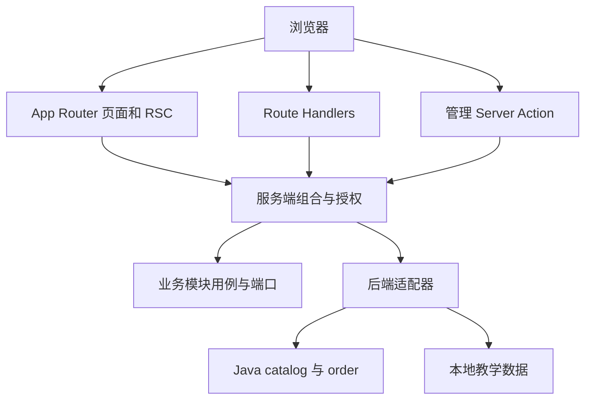

# 在线书店参考架构设计

基线为前端 `9caf4a0264f4450725431b90fb4e22502d53da47` 和 [建设指导书](../../project-guide.md)。Java 事实见[能力矩阵](../../integration/backend-capability-matrix.md)，新增契约见[Java 教学集成设计](2026-11-17-java-demo-integration-design.md)。本文用于实施前评审，文中的新路径、脚本、接口及行为均为设计目标。

## 1. 交付与边界

- 一个 Next.js 应用覆盖访客目录、购物车与结算、用户订单、管理员书籍编辑四条流程。教学模式可在同一台机器启动完整流程，包含两个顾客账号和一个管理账号。
- 真实模式先适配现有 Java catalog，再通过新增 v2 契约打通同一套目录、结算、订单和管理流程。v2 未验证时可运行只读目录。完整联调验收需连接 Java 和 OIDC 环境。
- 交付单一模块化实现、可执行架构规则、E2E、运行部署文档、四条 walkthrough、代表组件 Storybook，以及面向新人新增功能的指导。
- 交易教学覆盖报价过期、库存变化、重复提交、订单越权和编辑冲突。支付、配送履约、复杂促销和新增 Java 微服务不在范围内。允许对现有 catalog、order 和联调配置做配套改造。NestJS 专题属于 P5 的独立延伸。
- 保留 Node 24、pnpm 11.25.0、React 19.3.1、TypeScript 6.0.3 和 React Compiler。现有 Next.js 16.4.3 是勘察起点，已触发安全构建门禁。A1 先验证 Next.js 与 ESLint 配套的稳定安全补丁，采用修复线 16.4.5 以上并记录 ADR。后续依赖分别核验 peer、审计、构建与锁文件。

### 建设方式

| 路径                                 | 代价与收益                                                                   |
| ------------------------------------ | ---------------------------------------------------------------------------- |
| 先补齐全部基础设施再开发业务         | 共用能力可提前统一，但会在首个页面验证前投入身份、状态和数据库层             |
| 让四条流程分别开发后合并             | 可并行推进 UI，但会在 API、身份、布局和缓存边界上反复合并                    |
| 先做最小可运行基线，再按业务纵切交付 | 先验证渲染和目录契约，再增加结算所需的状态与身份。后续功能复用已经验证的边界 |

选择第三条。P0 固化契约及待证条件，P1/P2 交付首条纵切。P3 随首次写入实现教学会话、状态与事务。P4 复用它交付订单和管理。P5 交付运行证据与可复用文档。Java v2 与 P2–P4 并行，两个仓库的联调是 P5 的独立验收线。身份库、示例数据和部署参数由本设计给出参考默认值，可在验证中记录调整及影响范围。

## 2. 拓扑与代码边界

| 路径                                                           | 责任                                                 | 可依赖                                                                                                                          |
| -------------------------------------------------------------- | ---------------------------------------------------- | ------------------------------------------------------------------------------------------------------------------------------- |
| `src/app/[locale]/`、`src/app/api/v1/`                         | 页面、路由、响应映射、导航和组合组件                 | feature 公共入口、`shared`、`server` 公共入口                                                                                   |
| `src/features/{catalog,cart,checkout,orders,book-management}/` | 本功能的模型、UI、用例与端口                         | 自身、`shared`、适当的第三方库                                                                                                  |
| `src/server/`                                                  | 请求会话、能力判定、跨 feature 装配、真实/教学适配器 | feature 服务端与类型入口、`shared`                                                                                              |
| `src/shared/`                                                  | 组件、HTTP 传输、生成的 BFF DTO 和纯小工具           | 自身、适当的第三方库                                                                                                            |
| `src/i18n/`、`messages/`、`src/proxy.ts`                       | locale 路由、字典与翻译资源                          | 纯配置与 next-intl                                                                                                              |
| `test/`、`src/mocks/`                                          | 测试辅助、MSW、教学 fixture                          | 教学适配器仅接受服务器内部 fixture。测试工具留在测试图。`test/mocks/` 仅放测试 handlers，`src/mocks/fixtures/` 仅放教学 fixture |

- 压缩公开入口为 `client.ts`、`server.ts`、`model.ts`，按需出现。feature 不导入其他 feature 或 `app/server`，跨 feature 连接在 `app/[locale]/_composition` 或 `server`。纯模型不依赖 React、Next、网络或持久化。
- 所有秘密、会话、Java 调用及教学存储经 `server-only`。公开入口不混合客户端和服务器代码。Server Action 由 RSC 作为 prop 传给表单，客户端不直接导入 action 模块。
- dependency-cruiser 查环、深路径与跨 feature 引用。依赖图以 `'use client'` 为根检查所有传递依赖，Next 生产构建检查 `server-only`。架构 fixture 应证明违规图失败后可恢复，测试不会把坏源码留入发布构建。
- RSC 调用服务端组合函数，使用相同端口作为 BFF 和 Action 的底层数据路径。它不通过 HTTP 回调自己的 Route Handler。
- Session 和 QueryClient 不作为共享的服务端进程单例。SQLite 连接只用于数据库访问，本身不存请求身份。

## 3. 路由、渲染与状态

`zh-CN` 与 `en` 显式加前缀，根路径 307 到 `/zh-CN`，非法 locale 404。使用 next-intl，固定 `localeDetection: false`，根 HTML 迁至 `src/app/[locale]/layout.tsx`，从合法 locale 设置 lang。proxy 只匹配 `/`、`/zh-CN/:path*`、`/en/:path*`，未知 locale 交给路由直接 404。API、框架资源与公共资源不作语言重定向。shell 和 locale 字典可预渲染。页面中的原始书名、作者等归后端所有。

| 路径                                                                  | 访问和渲染                                       | 数据与状态                                                                                          |
| --------------------------------------------------------------------- | ------------------------------------------------ | --------------------------------------------------------------------------------------------------- |
| `/[locale]`                                                           | 公开静态首页                                     | 起始说明与目录导航，构建无外部访问                                                                  |
| `/[locale]/books`                                                     | 目录 RSC。读取 searchParams 的子树置于 Suspense  | URL `category,q,page`，以服务端结果为准。客户端只保留未提交的输入。修改筛选重置页码，浏览器后退恢复 |
| `/[locale]/books/[bookId]`                                            | RSC、静态 shell 与运行时详情。使用本地封面占位图 | UUID 校验，详情缓存。API 错误状态可断言，页面在流式已提交响应头后按 not-found UI/noindex 验收       |
| `/[locale]/cart`、`/[locale]/checkout`                                | 草稿在客户端，结算要求已登录顾客                 | Zustand 持久草稿、React Hook Form/Zod。报价与提交通过 BFF                                           |
| `/[locale]/sign-in`、`/[locale]/orders`、`/[locale]/orders/[orderId]` | 登录入口与动态受保护 RSC，独立 Suspense          | 订单首屏从服务端取数，详情使用按身份隔离的 Query hydration，取消经 BFF                              |
| `/[locale]/admin/books`、`/[locale]/admin/books/[bookId]`             | 动态受保护 RSC 和管理表格                        | TanStack Table 仅组合当前页，标题与版本表单提交 Server Action                                       |

### 3.1 URL 与公开缓存

- `CatalogQuery = { category?: string; q?: string; page: number }`。page 从 1 开始，最大 100，固定 12 条。重复字段或非整数 BFF 400，页面显示可重置的筛选错误。category trim 后 1–80，q 1–64。首发目录使用分类分页，关键词是教学扩展，v1 真实模式明确禁用并拒绝 `q`。分类来自 `CATALOG_CATEGORIES_JSON` 允许列表的原值。v2 支持 q 与真实分类枚举。
- Java v1 使用 `page-1,size=12`，仅在 page < 100 且满页时给下一页入口，允许遇到空尾页。教学数据以 UUID 排序，v1 不承诺稳定排序或总量，v2 用稳定排序与明确 hasNext。切换查询只通过 URL，不为目录首屏再引入 Query 缓存。
- 保留 `cacheComponents` 和 nodejs 运行时。locale 的静态参数由两个已知值生成。首页与 shell 零后端取数。书籍数据放在标明运行时边界的 Suspense 子树。先在 Suspense 内 `await connection()` 再调用公开缓存，避免预渲染读取 Java 或 SQLite。动态书籍路径不调用外部接口生成参数。
- 只缓存无身份的详情和没有关键词的分类列表前 10 页。缓存参数为 build profile、上游契约版本和不含秘密的 dataset 命名空间、locale、标准化 category/page 或书籍 UUID。缓存函数用 `'use cache'`、`cacheLife({stale:0,revalidate:60,expire:300})` 和 tags `catalog:lists`、`catalog:book:<id>`。请求对象、cookies、headers、session 和信号不进入缓存函数或 key。未缓存的 I/O 同样有超时。无此类缓存的新能力按失败率和延迟单独评估。
- 管理编辑成功后在 Server Action 调用 `updateTag`，先更新数据库再失效 detail/list，返回成功状态并刷新当前管理页面。已开目录页面在刷新或重新导航后读取更新值，部署样例支持单副本。目录库存为至多缓存窗口的提示，不作为加购前置条件，报价与提交始终读取最新权威库存。列明多副本需要可共享的 Next 缓存/失效传播。
- 保护入口先判定配置能力，再校验会话与资源。v1 只读的网页直接显示功能不可用，API 503，Action 返回 CAPABILITY_DISABLED。已支持能力缺会话网页回本地登录、API 401，外部对象按 404。私有 API `Cache-Control: private, no-store`，页面/代理不缓存个性化响应。QueryClient 的 dehydrate 只输出当前 viewer 范围内允许展示的数据。

### 3.2 客户端归属

| 数据         | 所有者               | 行为                                                                                                                                                                                                                                                          |
| ------------ | -------------------- | ------------------------------------------------------------------------------------------------------------------------------------------------------------------------------------------------------------------------------------------------------------- |
| 搜索/分页    | URL                  | 服务端重建与导航历史一致                                                                                                                                                                                                                                      |
| 购物数量     | Zustand              | 存版本化 `{v:1,revision,lines}`，仅 UUID/数量。损坏时恢复空草稿并提示。通过 IndexedDB 按 guest 或 opaque viewer scope 分存。shared 仅封装通用 DB，feature 管各自的序列化，跨 store 的业务事务由页面装配层执行。登录后显式导入游客草稿，注销保留原顾客分区     |
| 修改表单     | React Hook Form      | 服务端校验错误映射到对应字段。会话和标价无需由用户提交                                                                                                                                                                                                        |
| 订单远程副本 | TanStack Query       | server prefetch 每请求新建 client，客户端 provider 按 viewer scope 重建，query key 含 scope/orderId。数据 staleTime 15s，退出后清空进程内缓存并执行完整导航                                                                                                   |
| 认证         | 服务端会话和受信配置 | 浏览器可见最小展示字段，应用请求不携带客户 ID、角色、授权令牌作为输入。登录/注销/切账号后完整导航，确保 Router Cache 清理。BroadcastChannel 通知同源其他标签页，聚焦或 bfcache 恢复先遮罩私域视图再验证服务端 scope，不匹配则清理并完整导航。私域 Link 不预取 |

## 4. HTTP 与模块接口

BFF 手写维护 OpenAPI 3.1 源 `contracts/bff/v1.yaml`，独立维护带来源的 Java 目录子集 `contracts/java/catalog-v1.yaml` 与联调快照 `contracts/java/catalog-v2.yaml`、`contracts/java/order-v2.yaml`。openapi-typescript 生成 DTO，openapi-fetch 生成调用的类型约束，Zod 对实际输入及 Java 响应校验。SSR、Action 与 BFF 共用用例。教学订单接口与 Java 契约不做字段一比一镜像。

| 接口                                           | 请求/成功结果                                                                            | 权限与主要失败                                                    |
| ---------------------------------------------- | ---------------------------------------------------------------------------------------- | ----------------------------------------------------------------- |
| `GET /api/v1/catalog/books`                    | category/q/page，200 `{books,page,hasNext}`                                              | 公开，400 参数，422 v1 真实模式不支持关键词，502/503/504 上游故障 |
| `GET /api/v1/catalog/books/{bookId}`           | UUID，200 `Book`                                                                         | 公开，400 非法 ID，404 缺失，502/503/504 上游故障                 |
| `POST /api/v1/session/demo`                    | `{account:reader-a\|reader-b\|admin}`，204 并写 cookie                                   | 本地 demo。发布构建 404。错误 Origin 403                          |
| `GET /api/v1/session`                          | 200 `{viewer:null 或 {scope,role,name}}`                                                 | 私有 no-store，浏览器从服务器确认账号切换                         |
| `DELETE /api/v1/session`                       | 204 清会话                                                                               | 同源，教学与 OIDC 各自处理注销                                    |
| `POST /api/v1/checkout/quotes`                 | `{lines:[{bookId,quantity}]}` → 201 `Quote`                                              | 顾客。400 参数，409 缺货，503 未启用                              |
| `POST /api/v1/orders`                          | `{quoteId}` + UUID `Idempotency-Key`，201 已下单 `Submission` 或 202 已接受 `Submission` | 顾客。409 报价过期/变化/已消费或 key 冲突，503 未启用             |
| `GET /api/v1/order-submissions/{submissionId}` | 200 `Submission`                                                                         | 顾客，仅本人。404 未知或外部对象                                  |
| `GET /api/v1/orders`                           | page → 200 `{orders,page,hasNext}`                                                       | 当前顾客，仅按会话归属查询                                        |
| `GET /api/v1/orders/{orderId}`                 | UUID → 200 `OrderDetail`                                                                 | 当前顾客，对他人订单及未知 ID 均 404                              |
| `POST /api/v1/orders/{orderId}/cancel`         | `{reason,expectedVersion}` → 204                                                         | 当前顾客，404 隐藏外部对象，409 状态/版本冲突                     |
| `saveBookTitle` Server Action                  | `{bookId,title,expectedVersion}` → `ActionResult`                                        | 管理员。401/403/409 以安全的 action 结果码表示并保留字段反馈      |

- 所有 JSON 错误统一为 `{error:{code,requestId,fields?}}`。字段仅包含本应用可翻译的错误码。公共 API 400 invalid input、404 missing、422 unsupported filter、502 invalid/failed upstream response、503 未配置或临时不可用、504 deadline。私域另含 401、403、409。写入非 JSON 返回 415，超过 16 KiB 返回 413。无 body 的 DELETE 不要求 JSON。Server Action 使用框架表单协议、16 KiB 的 body 上限、显式来源与权限检查。应用拒绝返回可序列化结果码，框架层拒绝遵循框架 HTTP 形状。
- `Book` 含 id、title、author、category、priceMinor、currency、stock。管理编辑源另外含 version。`QuoteLine={bookId,title,quantity,unitPriceMinor}`，订单明细沿用同一行形状。金额汇总与币种在报价或订单级提供。`expiresAt` 是 UTC ISO-8601 字符串。金额以安全非负整数最小单位表示，CNY/USD 两位小数的目录展示，教学和真实交易仅 CNY，USD 报价 409 UNSUPPORTED_CURRENCY。订单/报价总价是服务端计算的应付总额，可包含服务端折扣，UI 不通过 items 重新推算。Java long 超安全范围返回 502。UI 格式化用 locale。真实 Java v1 目录遇到不支持的币种时按契约漂移返回清晰的 502，seed 只使用 CNY/USD。草稿数量 1–99，最多 20 项。UUID 小写标准化后判重。报价逐项乘法和累加检查安全整数，不接受混币或溢出总价。
- 使用 `CatalogPort.list(input: CatalogQuery): Promise<BookPage>`、`CatalogPort.get(bookId): Promise<Book | null>`、`CatalogPort.categories(): Promise<string[]>`。参数 locale 与缓存协调在装配层。真实适配器由服务端配置固定可信 origin，以 2s 总 deadline 请求上游，禁止 redirects，不向上游透传浏览器 cookie、传入 URL 或任意 headers。默认无自动重试。
- Checkout 端口持有 `quote(actor,lines)`、`place(actor,quoteId,key)` 与 `getSubmission(actor,id)`。Orders 端口持有 `list(actor,page)`、`get(actor,id)` 与 `cancel(actor,id,input)`。管理端口持有 `listForAdmin(actor,input)`、`getForAdmin(actor,id)` 与 `updateTitle(actor,input)`。权限、错误与数据归属在接口测试中可观察。

## 5. 运行模式和权限

| 模式          | 构建/启动                                                                             | 数据与会话                                                                           |
| ------------- | ------------------------------------------------------------------------------------- | ------------------------------------------------------------------------------------ |
| 本地开发/教学 | `pnpm dev:mock` 绑定 loopback。`pnpm build:demo` 与 `pnpm start:demo` 用 `.next-demo` | 显式教学适配、固定账号。容器单机课堂可映射到宿主 loopback                            |
| 发布          | `pnpm build` 与 `pnpm start` 使用 `.next`。镜像只复制发布构建                         | Java 目录。无 Java 配置可渲染首页并报告目录不可用。v1 只读，启用且验收 v2 后开放交易 |
| 真实本地联调  | `pnpm dev:real`。发布构建节点读取 runtime env                                         | 真实 Java、能力显式可用。v2 需 OIDC，v1 只读无需 IdP                                 |

- `BOOKSTORE_BUILD_TARGET` 选择构建目录。`next.config.env` 注入非秘密编译常量 `BOOKSTORE_BUILD_PROFILE`，取值 `demo|release`，装配和登录守卫直接读同名属性以便编译内联。仅已编译 demo profile 可装配本地教学适配器和教学登录。分离 distDir，启动脚本校验构建产物标记与要求的 profile。发布产物伪造运行时环境值仍不能启用教学入口。两套产物以生产方式构建和运行 E2E。篡改用例必须实际启动发布构建，通过健康 200，再对真实进程发送教学登录请求，期望 404 且无 Set-Cookie。独立测试启动器拒绝错误目录。
- `pnpm demo:seed` 为明确绝对路径 `DEMO_DATA_DIR` 创建 `demo.sqlite` 及 schema version。P2 随目录提供第一版读库、fixture 和 seed。P3 追加会话、报价、订单、幂等表。Node 24 的 `node:sqlite` 和 WAL 持久化进程间状态。写入先 `BEGIN IMMEDIATE` 再读报价与库存，锁竞争在有界等待后返回 503。单副本、独立每次测试数据目录。建表/seed 与 Next 模块导入分离，读取故障返回可诊断的 503。MSW 用于客户端/适配器测试，不承担正式教学模式的数据权威。
- 教学会话 `SESSION` 放不可预测的随机 token，库中存 hash、fixture account 与绝对过期时间。账号定义固定在服务端，role 从账号读取。默认 1 小时。注销删除行并清 cookie。HttpOnly、SameSite=Lax、无 Domain、Path=/，在 HTTPS 环境加 Secure。HTTP 教学会话仅 loopback，教学模式页面有醒目提示。
- 同源写操作由配置的 `APP_ORIGIN` 校验 Origin，代理信任配置固定。没有 Origin 或不匹配返回 403。Server Action 在框架来源校验外显式校验 `APP_ORIGIN`（缺 Origin 也拒绝）并逐次授权，不将 Proxy、页面可见性或客户端角色作为授权。登录返回只接受本地已知 locale 路径，拒绝协议、双斜杠、反斜杠及其编码表示，失败回 locale 首页。
- 真实 v2 使用 Better Auth + Generic OAuth Keycloak + PostgreSQL 会话。按[集成设计](2026-11-17-java-demo-integration-design.md)验证 issuer、audience、PKCE、callback、角色和对象归属。仅 Java 已启用受保护 v2 后开放真实私有路由。
- 真实扩展准入覆盖身份绑定、权威价格、库存、并发条件和端到端幂等。幂等记录及交易结果归 Java order，BFF 不维护第二份订单状态。

## 6. 业务流程与故障语义

### 6.1 浏览与详情

访客切换分类、翻页、打开详情及切换语言。URL 可复制，正常导航和直接请求都可渲染。详情未知 ID 显示返回入口。上游故障给重试提示。公共缓存用不涉及用户的样例证明 hit 和更新。真实付费相关数据不会从浏览器报价或静态 placeholder 推断。

### 6.2 购物车与结算

1. 用户加书、改数量并刷新恢复。在结算页登录顾客后，显式将访客草稿导入其名下。结算前显示估计金额。服务端按当前数据源生成绑定 actor 的报价。
2. `Quote` 含 `quoteId,expiresAt,lines,totalMinor,currency`，10 分钟有效。快照保存标准化 lines 与权威价格。本地教学创建订单时，在 SQLite 同一写事务内核对归属、有效期、价格与库存并消费报价，写入订单/明细、扣减库存及幂等记录。用户在客户端不得改发标题、单价、邮箱、customerId。
3. 幂等作用域为 `(actorId,key)`。同 key 同 quote 已成功时返回原 201 及完整不可变响应，订单后续取消不改变提交回执，先检查成功记录，再检查该报价是否被另一个 key 消费，最后判断是否过期。不同 quote 409。仅允许每个 quote 生成一笔订单。数据库唯一约束与事务对并发两请求生效。
4. 浏览器把当前 scope 的草稿和待提交记录放在同一 IndexedDB，先在一次 readwrite 事务中重读 revision 及已有的 pending。每个 scope 仅有一个未完成的提交，事务成功 pin 唯一 quoteId/key/revision 后才发 HTTP。其他标签读到 pin 后恢复同一请求。收到已验证响应后按固定 key 补 submissionId。超时保留记录并提示同 key 重试，202 表示受理，按 ID 最长轮询 30 秒，刷新续查。待核对仍保留原 key，明确业务拒绝且服务端证明未接单后才重新报价。`QUOTE_USED` 与 `IDEMPOTENCY_CONFLICT` 保留原上下文并提示查询订单或核对原提交。成功时在同一 IndexedDB 事务中匹配 key 并比较当前草稿 revision，条件清草稿和当前 pending。两标签同时提交不同报价也只允许一个意图。用户新编辑不丢失。IndexedDB 不可用时显示不可恢复原因，关闭提交，可继续浏览。
5. Java 停止接单时，BFF 仍转发原 key 的已受理重放和状态查询。Java 在身份、输入校验和 owner/key 查找后，仅拒绝新的提交。
6. `Submission` 为按 state 区分的联合。共有 `submissionId`，`PLACED` 必有 `order:{orderId,status,totalMinor,currency}`，`REJECTED` 必有白名单 `reason`，`PROCESSING` 和 `RECONCILE_REQUIRED` 无 order 或 reason。教学正常提交返回 201，测试可编程 stub 覆盖 202→PLACED。Java v2 POST 一律返回 202（含已终态的正确重放），GET 一律 200，客户端以 state 判断后续行为。

### 6.3 订单与取消

- 订单列表 `page=1..100` 分页，详情 SSR。列表项含 orderId、status、totalMinor、currency，详情另含 lines 与当前 version（从 0 起）。未登录页面转登录，同源 API 401。顾客 B 请求顾客 A 的真实存在 ID 与不存在 ID 获得同样 404 形状，且没有 A 的数据。
- 教学订单状态使用 `PLACED|CONFIRMED|SHIPPED|CANCELLED`，创建为 PLACED。取消仅允许 PLACED/CONFIRMED，reason trim 1–200，expectedVersion 与库内版本比较。取消与库存释放同事务。已取消或已发货 409。默认等待 204 后失效 Query 并刷新受影响 RSC，冲突重取详情并保留输入。
- 只在订单详情呈现本地“正在取消”，订单状态等服务端确认。P5 walkthrough 用示例说明乐观更新和回滚为何不适用于不明结果的交易写入。

### 6.4 管理编辑

- 管理员查书、筛选和分页，仅编辑标题。title trim 1–120，expectedVersion 为非负整数。用 `WHERE id=? AND version=?` 更新版本，过期编辑保留输入并反馈冲突，明确重新加载后再保存。顾客直接访问页面或尝试调用 action 均拒绝。
- RSC 将 `saveBookTitle` 作为 action prop 交给表单。同一业务没有第二个 BFF 写入口。页面展示已验证的写回结果，目录下次读取也能看见更新。
- TanStack Table 使用受控筛选和服务器分页。虚拟化只在 P5 的可复现大数据例子里测量和展示，不改变主业务列表。

## 7. 验证、运行和文档

| 检查层         | 验收重点                                                                                                                        |
| -------------- | ------------------------------------------------------------------------------------------------------------------------------- |
| 纯模型 / 组件  | URL 边界、非法或旧草稿、整数金额、字段错误、键盘焦点与语义化                                                                    |
| HTTP / 契约    | BFF DTO、真实适配器 404/格式损坏/超时、强制 Origin、身份、业务 DTO、无 session/email 泄漏                                       |
| 生产构建 E2E   | demo 和发布两个产物。demo 四链路、两身份、超时重试、并发写入、缓存更新。发布尝试运行时伪造 demo，实际入口依然关闭               |
| 质量门禁       | 冻结安装、peer 检查、生成差异、依赖图、Vitest、生产构建、Playwright。单独手动 real integration 记录确切 Java SHA 和环境         |
| 运行与可观测性 | 只读健康、依赖就绪检查、Node/Docker 单副本，部署时注入 secret，日志和 OpenTelemetry 按 requestId/trace 关联，压测保留环境和样本 |
| 架构文档       | 六主题 overview 与四条 walkthrough 绑定实际入口及测试。ADR 记录 profile、cache、身份及真实集成边界。读者可本地重放              |

版本及能力不在文档讨论中标记为已实现，实施完成后据命令输出或运行验收更新 README。发布定义区分“教学流程已通过”“Java v1 目录 HTTP 已验证”“Java v2 含 OIDC 四流程通过”“NestJS 专题已完成”。真实 v2 需联调四条流程并提供规定的授权、故障和事件证据。

官方参考为 [Next.js BFF](https://nextjs.org/docs/app/guides/backend-for-frontend)、[Cache Components](https://nextjs.org/docs/app/getting-started/caching)、[connection](https://nextjs.org/docs/app/api-reference/functions/connection)、[updateTag](https://nextjs.org/docs/app/api-reference/functions/updateTag)、[next.config env](https://nextjs.org/docs/app/api-reference/config/next-config-js/env)、[自托管](https://nextjs.org/docs/app/guides/self-hosting)、[next-intl locale 路由](https://next-intl.dev/docs/routing/setup)、[Node SQLite](https://nodejs.org/docs/latest-v24.x/api/sqlite.html)、[Better Auth Next.js](https://better-auth.com/docs/integrations/next) 与 [Generic OAuth](https://better-auth.com/docs/plugins/generic-oauth)。
